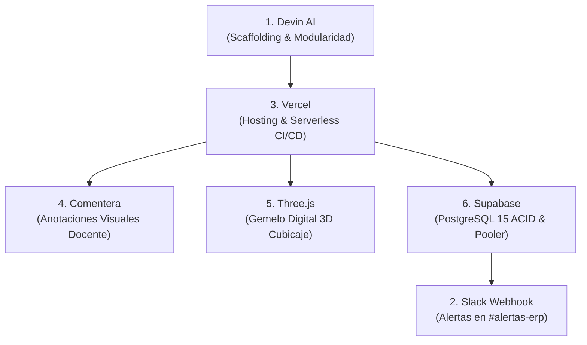
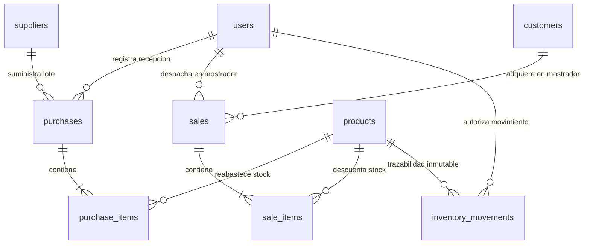

# EXPEDIENTE MAESTRO DE DEFENSA DE GRADO: 20 DIAPOSITIVAS Y DOCUMENTACIÓN TÉCNICA
## DIPLOMADO EN TECNOLOGÍAS INFORMÁTICAS
### Proyecto Final de Integración Empresarial: ERP Mayorista "Oki Doki" (Distribol)

---

| DATOS OFICIALES DEL PROYECTO | ESPECIFICACIÓN ACADÉMICA |
| :--- | :--- |
| **Programa de Posgrado:** | Diplomado en Tecnologías Informáticas |
| **Módulo Académico:** | **TECNOLOGÍAS INFORMÁTICAS** |
| **Docente / Evaluadora:** | **Ing. Lucy Quintero Gutiérrez** |
| **Estudiante / Postulante:** | **Carlos Daniel Montero Justiniano** |
| **Código de Estudiante:** | **19591** |
| **Entidad de Aplicación:** | Distribuidora Mayorista "Oki Doki" (Distribol) |
| **Fecha de Presentación:** | Octubre 2026 |
| **Sede:** | Santa Cruz de la Sierra, Bolivia |
| **Aplicación Web en Producción:** | [https://frontend-rho-sable-26.vercel.app](https://frontend-rho-sable-26.vercel.app) |
| **Repositorio Oficial en GitHub:** | [https://github.com/CarlosDMJ/Tienda/tree/erp-okidoki](https://github.com/CarlosDMJ/Tienda/tree/erp-okidoki) |

---

# ÍNDICE GENERAL DEL EXPEDIENTE
1. [Ficha Técnica de Producción y Stack](#1-ficha-técnica-de-producción-y-stack)
2. [Reglas de Negocio Vinculantes y el Paradigma "Cero Transportistas"](#2-reglas-de-negocio-vinculantes)
3. [Matriz de Trazabilidad: Las 6 Herramientas del Diplomado](#3-matriz-de-las-6-herramientas)
4. [Especificación del Modelo de Dominio (Los 5 Sectores)](#4-especificación-de-los-5-sectores)
5. [Ciberseguridad y Suite de Pruebas Automatizadas](#5-ciberseguridad-y-pruebas)
6. [Estructura Completa de las 20 Diapositivas (Contenido, Diagramas y Speech)](#6-estructura-de-las-20-diapositivas)
7. [Mega-Prompt para Gemini (Generación de Diapositivas)](#7-mega-prompt-para-gemini)

---

<a name="1-ficha-técnica-de-producción-y-stack"></a>
# 1. FICHA TÉCNICA DE PRODUCCIÓN Y STACK

* **Capa Frontend:**
  * Vanilla JavaScript ES6+ (arquitectura modular basada en controladores asíncronos y Fetch API).
  * HTML5 semántico y CSS3 con variables corporativas (`--primary: #1e293b`, `--accent: #f59e0b`).
  * Motor 3D interactivo WebGL mediante **Three.js (r128)** con `OrbitControls` y luces volumétricas.
  * Widget colaborativo de feedback docente mediante **Comentera** (`okidoki-erp-bolivia`).
* **Capa Backend:**
  * **FastAPI** (Python 3.11.9) ejecutado como microservicios *Serverless* en **Vercel** (`@vercel/python`).
  * Validación y coerción de esquemas mediante **Pydantic v2**.
  * Seguridad perimetral con tokens criptográficos **JWT** (`HS256`, 2 horas de validez).
  * Notificaciones operativas asíncronas vía **Slack Incoming Webhooks** en `#alertas-erp`.
* **Capa de Persistencia:**
  * Motor de Base de Datos relacional **PostgreSQL 15** alojado en **Supabase Cloud** (AWS Ohio).
  * Mapeo objeto-relacional (ORM) mediante **SQLAlchemy** con protección anti-inyección SQL.
  * Gestión de conexiones concurrentes mediante **Transaction Connection Pooler IPv4** (puerto 6543).

---

<a name="2-reglas-de-negocio-vinculantes"></a>
# 2. REGLAS DE NEGOCIO VINCULANTES

1. **Giro Comercial Mayorista Exclusivo:** Toda la mercadería se comercializa en empaques cerrados de fábrica con código **SKU normalizado** (cajas de 12 o 24 unidades, fardos de 10 a 20 paquetes, quintales de 50 kg). No se permite el menudeo ni el raleo.
2. **Moneda Oficial Única — Bolivianos (`Bs.`):** Todos los costos de adquisición, precios de venta mayorista, subtotales facturados y saldos de Kardex se calculan y registran exclusivamente en `Bs.`.
3. **Restricción Crítica (Cero Transportistas):** "Oki Doki" opera bajo la modalidad de **entrega presencial en mostrador de almacén central**. Queda **estrictamente prohibido** agregar tablas de choferes, rutas logísticas, camiones o fletes de reparto.
4. **Garantía Transaccional ACID en Tiempo Real:** Al momento del cobro (*checkout*), el backend valida existencias físicas:
   $$\text{stock\_actual} \ge \text{cantidad\_solicitada}$$
   Si un solo ítem carece de saldo suficiente, se aborta la venta completa ejecutando `db.rollback()` y arrojando código `HTTP 400 Bad Request`.

---

<a name="3-matriz-de-las-6-herramientas"></a>
# 3. MATRIZ DE LAS 6 HERRAMIENTAS TECNOLÓGICAS



| # | Herramienta | Rol en el Proyecto | Implementación y Evidencia en Código |
| :-: | :--- | :--- | :--- |
| **1** | **Devin AI** | Asistente de Ingeniería de Software | Generación de la estructura base del frontend modular, diseño de controladores asíncronos con `fetch()` y estructuración de componentes en `frontend/app.js`. |
| **2** | **Slack** | Canal de Alertas Operativas en Tiempo Real | Webhook entrante implementado en `api/main.py` (`notificar_slack()`). Notifica en `#alertas-erp` cada venta confirmada y alertas de stock crítico. |
| **3** | **Vercel** | Infraestructura Cloud y Pipeline CI/CD | Despliegue automatizado conectado a GitHub. Provee CDN global, certificado SSL TLS 1.3 y ejecución híbrida: interfaz estática + Serverless Python Functions (`@vercel/python`). |
| **4** | **Comentera** | Feedback y Colaboración Visual | Script incrustado en `frontend/index.html` (`data-project-id="okidoki-erp-bolivia"`) permitiendo a la docente dejar notas interactivas sobre la UI. |
| **5** | **Three.js** | Visualización Tridimensional e Interactiva | Canvas WebGL con `OrbitControls` y luces de estudio que renderiza cajas y fardos con rotación orbital 360°, texturas y simulación de cubicaje según el SKU. |
| **6** | **Supabase** | Motor de Base de Datos Relacional Cloud | Instancia gestionada de **PostgreSQL 15** con integridad referencial estricta, llaves foráneas en cascada, transacciones ACID y conexión mediante Transaction Pooler IPv4. |

---

<a name="4-especificación-de-los-5-sectores"></a>
# 4. ESPECIFICACIÓN DE LOS 5 SECTORES DEL DOMINIO



* **Sector 1: Usuarios, Roles y Seguridad RBAC (`users`):**  
  Control de accesos mediante perfiles operativos (`Administrador`, `Cajero/Vendedor`, `Encargado de Almacén`). Tokens firmados criptográficamente con algoritmo `HS256` y tiempo de vida de 120 minutos.
* **Sector 2: Catálogo e Inventario Mayorista (`products`):**  
  Control de costos mayoristas, precios de mostrador, cálculo de márgenes ($\text{precio\_venta} > \text{precio\_compra} > 0$), control de bultos cerrados y visualización del cubicaje en 3D con Three.js.
* **Sector 3: Proveedores y Compras (`suppliers`, `purchases`, `purchase_items`):**  
  Abastecimiento respaldado con NIT fiscal de industrias bolivianas (Fino, Guabirá, PIL, Famosa, Embol). Suma física de existencias: $\text{stock} = \text{stock} + \text{cantidad\_comprada}$, actualización del costo unitario pactado e inserción automática de asiento de `ENTRADA` en Kardex.
* **Sector 4: Clientes y Ventas Mostrador (`customers`, `sales`, `sale_items`):**  
  Punto de venta atómico con validación previa de stock disponible. En caso de suficiencia: descuenta unidades, genera comprobante (`VTA-YYYYMMDD-XXXX`), inserta movimiento de `SALIDA` en Kardex y consolida con `db.commit()`. Ante quiebre: `db.rollback()` inmediato arrojando `HTTP 400 Bad Request`.
* **Sector 5: Kardex e Inmutabilidad de Auditoría (`inventory_movements`):**  
  Bitácora forense de solo adición (*append-only*). Registra la fotografía exacta del movimiento:
  $$\text{Cantidad Previa} \pm \text{Cantidad} = \text{Cantidad Final}$$

---

<a name="5-ciberseguridad-y-pruebas"></a>
# 5. CIBERSEGURIDAD Y SUITE DE PRUEBAS AUTOMATIZADAS

### Controles de Ciberseguridad Auditados
1. **Inyección SQL Eliminada:** El 100% de las operaciones se ejecutan mediante SQLAlchemy ORM parametrizado.
2. **Validación Estricta de Esquemas:** Pydantic v2 rechaza estructuras JSON malformadas (`HTTP 422`).
3. **Aislamiento de Secretos:** Credenciales (`DATABASE_URL`, `SECRET_KEY`, `SLACK_WEBHOOK_URL`) aisladas en entorno `.env`.

### Resultados de la Suite Automatizada (`backend/test_api.py`)

| Caso de Prueba Auditado | Condición Evaluada | Resultado |
| :--- | :--- | :---: |
| `test_login_valido_admin` | Emisión de JWT válido para usuario `admin` | 🟢 **APROBADO** |
| `test_login_credenciales_invalidas` | Respuesta `401 Unauthorized` ante contraseña incorrecta | 🟢 **APROBADO** |
| `test_rutas_protegidas_sin_token` | Bloqueo perimetral ante peticiones anónimas | 🟢 **APROBADO** |
| `test_venta_exitosa_descuento_stock` | Descuento exacto de unidades físicas y registro en Kardex | 🟢 **APROBADO** |
| `test_venta_rechazada_stock_insuficiente`| Bloqueo transaccional preventivo `400 Bad Request` | 🟢 **APROBADO** |
| `test_rollback_atomico_acid` | Integridad intacta de existencias tras cancelar la orden | 🟢 **APROBADO** |
| `test_balance_matematico_kardex` | Cumplimiento estricto: $\text{Previa} \pm \text{Cantidad} = \text{Final}$ | 🟢 **APROBADO** |

---

<a name="6-estructura-de-las-20-diapositivas"></a>
# 6. ESTRUCTURA COMPLETA DE LAS 20 DIAPOSITIVAS

### DIAPOSITIVA 1: Portada Académica Institucional
* **Título:** Sistema ERP Mayorista de Compra-Venta e Inventario "Oki Doki" (Distribol)
* **Subtítulo:** Proyecto Final de Integración Empresarial — Diplomado en Tecnologías Informáticas
* **Datos:**
  * **Docente / Evaluadora:** Ing. Lucy Quintero Gutiérrez
  * **Postulante:** Carlos Daniel Montero Justiniano (Código: 19591)
  * **Sede:** Santa Cruz de la Sierra, Bolivia — Octubre 2026
  * **Producción:** `https://frontend-rho-sable-26.vercel.app` | **GitHub:** `CarlosDMJ/Tienda`
* **Speech del Expositor:**  
  > *"Muy buenos días estimada docente Ing. Lucy Quintero Gutiérrez y miembros del tribunal evaluador. Mi nombre es Carlos Daniel Montero Justiniano, con código de estudiante 19591. Tengo el honor de presentar la defensa de grado de nuestro proyecto final: el Sistema ERP Mayorista 'Oki Doki' (Distribol), una solución full-stack en la nube desarrollada con FastAPI, PostgreSQL en Supabase y Vercel, fundamentada en 5 sectores de dominio y la articulación nativa de 6 herramientas tecnológicas de vanguardia."*

---

### DIAPOSITIVA 2: Resumen Ejecutivo y Problemática Operativa
* **Diagnóstico de Negocio:** Las distribuidoras comerciales en Bolivia sufren pérdidas críticas por descuadres de stock físico, sobreventas simultáneas (*overselling*), falta de trazabilidad en compras y cálculos manuales propensos al error humano.
* **Propósito del ERP:** Implementar un Producto Mínimo Viable (MVP) empresarial de alta disponibilidad, con tolerancia cero a sobreventas y trazabilidad forense de existencias.
* **Speech del Expositor:**  
  > *"El proyecto nació de una necesidad real del mercado mayorista boliviano: erradicar los quiebres de inventario y los cobros desfasados. Nuestro objetivo fue desarrollar un software robusto que impida que dos cajeros vendan la misma mercadería física al mismo tiempo y que garantice que cada centavo y cada bulto que entra al almacén quede asentado de forma inmutable."*

---

### DIAPOSITIVA 3: Las 4 Reglas de Negocio Vinculantes de Oki Doki
* **1. Unidades de Empaque Cerrado:** Manejo por cajas, fardos y quintales con código SKU normalizado (prohibida la venta al menudeo).
* **2. Moneda Nacional Oficial:** Totalidad de cotizaciones, precios de venta, costos y kardex valorizados en **Bolivianos (`Bs.`)**.
* **3. Cero Transportistas:** Despacho presencial exclusivo en mostrador de almacén central.
* **4. Consistencia Transaccional ACID:** Validación previa de stock; ante saldo insuficiente, se revierte la orden con `db.rollback()`.
* **Speech del Expositor:**  
  > *"El sistema se diseñó bajo cuatro reglas cardinales. La primera garantiza que la mercadería se gestione únicamente en bultos de fábrica cerrados; la segunda asegura que toda la contabilidad opere estrictamente en nuestra moneda nacional, los Bolivianos; la tercera elimina costos de reparto; y la cuarta asegura la integridad física de nuestro inventario mediante transacciones ACID."*

---

### DIAPOSITIVA 4: Justificación Arquitectónica: ¿Por qué "Cero Transportistas"?
* **Alineación con el Giro Comercial:** "Oki Doki" es un centro mayorista de abastecimiento y retiro en punto de venta, no una empresa de delivery.
* **Eficiencia Financiera:** La empresa elimina los costos de mantenimiento de camiones, planillas de choferes y seguros de ruta, transfiriendo ese ahorro a mejores precios de mostrador.
* **Decisión de Diseño de Software:** Se prohibió expresamente incluir tablas de envíos, hojas de ruta o roles de conductor, protegiendo la cohesión del modelo de dominio.
* **Speech del Expositor:**  
  > *"Es fundamental aclarar que la ausencia de un módulo de choferes y despachos externos no es un descuido, sino una decisión estratégica y consciente. 'Oki Doki' opera bajo el modelo de retiro directo en mostrador de almacén central para optimizar costos de flete. Incluir transportistas habría violado las reglas de negocio de la empresa y desvirtuado el propósito del software."*

---

### DIAPOSITIVA 5: Arquitectura Cloud Híbrida y Desacoplada
* **Capa Frontend:** Distribución perimetral de baja latencia en Vercel Edge Network con SSL TLS 1.3.
* **Capa Backend:** FastAPI (Python 3.11) ejecutado en modo Serverless Functions (`@vercel/python`) mediante `api/index.py`.
* **Capa de Persistencia:** PostgreSQL 15 en Supabase Cloud con Connection Pooler IPv4 en puerto 6543.
* **Capa de Notificaciones:** Webhooks asíncronos hacia canales operativos de Slack.
* **Speech del Expositor:**  
  > *"Rompimos con la arquitectura monolítica tradicional para adoptar un modelo desacoplado en la nube. La interfaz web estática se entrega instantáneamente desde los servidores perimetrales de Vercel; la lógica de negocio se procesa de forma elástica en FastAPI mediante funciones serverless; y la consistencia transaccional se garantiza en PostgreSQL de Supabase. Esto nos brinda alta disponibilidad 24/7 y cero costos de servidor en reposo."*

---

### DIAPOSITIVA 6: Matriz de Integración de las 6 Herramientas del Diplomado
* **Trazabilidad de Competencias:**
  1. **Devin AI:** Ingeniería de software y arquitectura asíncrona modular.
  2. **Slack:** Webhook de notificaciones operativas en `#alertas-erp`.
  3. **Vercel:** Plataforma de hosting global y pipeline CI/CD Serverless.
  4. **Comentera:** Widget de retroalimentación y auditoría visual docente.
  5. **Three.js:** Modelado y visualización tridimensional WebGL de empaques.
  6. **Supabase:** Base de datos relacional PostgreSQL con garantía ACID.
* **Speech del Expositor:**  
  > *"Cumplimos de forma rigurosa con la totalidad de herramientas exigidas en el diplomado. No fueron adiciones decorativas: cada tecnología cumple una función indispensable dentro del ecosistema del ERP, complementando el diseño asistido por IA, la observabilidad operativa en Slack y la persistencia relacional en Supabase."*

---

### DIAPOSITIVA 7: Herramientas 1 & 3: Devin AI y Vercel
* **Devin AI:** Asistente autónomo utilizado en la concepción del controlador modular `frontend/app.js`, la estandarización de llamadas `fetch()` y el manejo del token JWT en `localStorage`.
* **Vercel:** Despliegue automatizado conectado a GitHub. Ejecución híbrida donde `vercel.json` rutea las peticiones `/api/(.*)` hacia el runtime `@vercel/python` en `api/index.py`.
* **Speech del Expositor:**  
  > *"Utilizamos Devin AI como acelerador de ingeniería para generar una base de código JavaScript limpia, modular y sin dependencias pesadas. Para el despliegue, Vercel automatiza el pipeline de integración continua desde GitHub, ejecutando tanto los archivos visuales como nuestro backend en Python sin necesidad de configurar servidores Linux dedicados."*

---

### DIAPOSITIVA 8: Herramientas 2 & 4: Slack Webhooks y Comentera
* **Slack Webhooks (`#alertas-erp`):** La función `notificar_slack()` dispara un payload HTTP POST ante cada venta confirmada y cada vez que un producto cae en stock crítico ($stock \le 10$).
* **Comentera:** Script interactivo (`widget.js`) con ID `okidoki-erp-bolivia` incrustado en el DOM que permite a la docente dejar anotaciones visuales y observaciones directamente sobre la interfaz en producción.
* **Speech del Expositor:**  
  > *"La observabilidad del negocio se delegó a Slack: la gerencia recibe en tiempo real el detalle de cada comprobante emitido y las alertas de reposición inmediata. Por su parte, la integración de Comentera permite a la Ing. Lucy Quintero y al tribunal evaluar la interfaz y dejar comentarios visuales anclados a cualquier elemento de la pantalla."*

---

### DIAPOSITIVA 9: Herramientas 5 & 6: Three.js y Supabase
* **Three.js WebGL:** Canvas con renderizado orbital 360° e iluminación de estudio que simula el volumen, proporciones de estiba y empaque de cada producto según el SKU activo.
* **Supabase PostgreSQL 15:** Persistencia relacional en la nube conectada a través de SQLAlchemy ORM y Transaction Pooler IPv4 para soportar alta concurrencia transaccional.
* **Speech del Expositor:**  
  > *"En el rubro mayorista, el factor volumétrico es determinante. Incorporamos Three.js para que el operador y el cliente verifiquen el cubicaje y las dimensiones de estiba de la carga antes de retirarla. En el almacenamiento, Supabase nos otorga la garantía de un motor PostgreSQL 15 con llaves foráneas estrictas e integridad referencial."*

---

### DIAPOSITIVA 10: Modelo de Dominio — Diagrama Entidad-Relación (DER)
* **Entidades Normalizadas (3NF):**
  * `users` (Usuarios y roles RBAC).
  * `products` (Catálogo maestro de empaques mayoristas).
  * `suppliers` y `purchases` / `purchase_items` (Abastecimiento y lotes).
  * `customers` y `sales` / `sale_items` (Ventas y comprobantes mostrador).
  * `inventory_movements` (Kardex inmutable de auditoría).
* **Speech del Expositor:**  
  > *"El modelo de datos se estructuró bajo la tercera forma normal, asegurando que no existan redundancias ni anomalías de actualización. La tabla de productos actúa como nodo central que articula las compras a proveedores, las ventas a clientes y el registro cronológico del kardex."*

---

### DIAPOSITIVA 11: Sector 1 — Usuarios, Roles y Seguridad RBAC
* **Autenticación Criptográfica:** Emisión de tokens **JWT (`HS256`)** con validez de 2 horas. Las rutas protegidas validan el encabezado `Authorization: Bearer <token>`.
* **Los 3 Roles de Operación:**
  1. `Administrador`: Configuración integral, catálogo, compras y kardex.
  2. `Cajero/Vendedor`: Atención en mostrador, emisión de comprobantes y consulta de stock.
  3. `Encargado de Almacén`: Recepción de lotes, ajustes y control de stock mínimo.
* **Speech del Expositor:**  
  > *"El Sector 1 gobierna el control de accesos mediante un Login Gateway seguro. Cada operador recibe un token JWT firmado criptográficamente. El sistema valida los permisos en cada endpoint, garantizando que un cajero solo pueda emitir ventas y consultar existencias, impidiendo modificaciones no autorizadas en costos o configuraciones maestras."*

---

### DIAPOSITIVA 12: Sector 2 — Catálogo e Inventario Mayorista
* **Reglas de Catálogo:** Precios expresados en Bolivianos (`Bs.`), validación estricta $\text{precio\_venta} > \text{precio\_compra} > 0$ y existencias físicas no negativas.
* **Catálogo Maestro Precargado:** Cajas de Aceite Fino, Fardos de Arroz Grano de Oro, Quintales de Azúcar Guabirá, Fideos Famosa, Leche Pil, Refrescos Coca-Cola y Detergente OMO.
* **Alerta Preventiva:** Disparo de advertencia cuando $\text{stock} \le 10$ unidades.
* **Speech del Expositor:**  
  > *"El Sector 2 gestiona los bultos cerrados de las industrias más prestigiosas del país. Cada ítem posee un código SKU irrepetible y un umbral mínimo de seguridad. Si el stock cae a 10 unidades o menos, el catálogo resalta el producto en color ámbar y notifica a Slack para ordenar su reabastecimiento inmediato."*

---

### DIAPOSITIVA 13: Sector 3 — Proveedores y Compras de Abastecimiento
* **Empresas Proveedoras de Bolivia:** Industrias de Aceite Fino S.A., Ingenio Azucarero Guabirá S.A., PIL Andina S.A., Fábrica de Fideos Famosa S.A., EMBOL S.A.
* **Efecto Transaccional Inmediato:**
  1. Registro documental con Número de Factura fiscal y NIT.
  2. Incremento síncrono: $\text{stock\_actual} = \text{stock\_actual} + \text{cantidad\_comprada}$.
  3. Actualización automática del último costo pactado (`cost_price`).
  4. Generación síncrona del asiento de `ENTRADA` en el Kardex.
* **Speech del Expositor:**  
  > *"El Sector 3 formaliza la cadena de suministros con registro de facturación legal boliviana. Al registrar una compra, el inventario se actualiza de inmediato, se ajusta el costo de adquisición del producto y se crea el correspondiente comprobante de entrada en la bitácora de auditoría."*

---

### DIAPOSITIVA 14: Sector 4 — Ventas Mostrador con Garantía Atómica ACID
* **Punto de Venta en Mostrador:** Despacho presencial con retiro en almacén central.
* **Algoritmo Atómico de Venta:**
  1. Apertura de transacción con `db.begin()`.
  2. Validación en tiempo real de disponibilidad: $\text{stock\_actual} \ge \text{cantidad\_solicitada}$.
  3. Si falta stock: `db.rollback()` inmediato arrojando `HTTP 400 Bad Request`.
  4. Si hay stock: Descuenta unidades, emite comprobante (`VTA-YYYYMMDD-XXXX`), inserta movimiento de `SALIDA` en Kardex, consolida con `db.commit()` y envía notificación a Slack.
* **Speech del Expositor:**  
  > *"En el Sector 4 radica la solidez operativa del sistema. Si múltiples cajeros atienden simultáneamente en el mostrador, el backend garantiza aislamiento transaccional estricto. Si no hay existencia física suficiente para abastecer la orden completa, el cobro se cancela en su totalidad, erradicando el riesgo de sobreventas y descuadres de caja."*

---

### DIAPOSITIVA 15: Sector 5 — Kardex e Inmutabilidad Forense de Auditoría
* **Bitácora Inmutable (*Append-Only*):** Prohibición terminante de sentencias `UPDATE` o `DELETE` sobre `inventory_movements`.
* **Fotografía de Estado Matemática:**
  $$\text{Cantidad Previa} \pm \text{Cantidad} = \text{Cantidad Final}$$
* **Tipos de Movimientos:** `ENTRADA` (Compras), `SALIDA` (Ventas Mostrador) y `AJUSTE` (Mermas autorizadas por Almacén).
* **Speech del Expositor:**  
  > *"El Sector 5 proporciona trazabilidad forense absoluta. Cada movimiento de mercancía genera un registro inmutable con marca de tiempo UTC y documento de respaldo legal. La ecuación matemática garantiza que el inventario teórico coincida con el inventario físico en cualquier arqueo de almacén."*

---

### DIAPOSITIVA 16: Ciberseguridad e Integridad de Datos
* **Mitigación de Inyección SQL:** Consultas 100% gestionadas mediante SQLAlchemy ORM parametrizado.
* **Esquemas Estrictos con Pydantic v2:** Validación previa de payloads JSON y rechazo automático de datos corruptos (`HTTP 422`).
* **Protección CORS Configurada:** Acceso seguro controlado entre Vercel y los endpoints de la API.
* **Aislamiento de Secretos:** Llaves criptográficas y cadenas de conexión resguardadas en variables de entorno seguras (`.env`).
* **Speech del Expositor:**  
  > *"La ciberseguridad fue implementada por diseño en cada capa del software. Al utilizar SQLAlchemy ORM eliminamos por completo cualquier riesgo de inyección SQL. Pydantic filtra y valida cada parámetro de entrada, y las credenciales críticas de Supabase y Slack permanecen estrictamente cifradas y aisladas del cliente."*

---

### DIAPOSITIVA 17: Calidad de Software: Suite de Pruebas Automatizadas
* **Suite de Pruebas Unitarias e Integración:** [`backend/test_api.py`](file:///c:/xampp/htdocs/Diplomado/backend/test_api.py).
* **Resultados Auditados:** 7 de 7 pruebas aprobadas exitosamente (100% de éxito).
  * Autenticación válida e inválida con JWT.
  * Protección perimetral de rutas privadas.
  * Descuento exitoso de stock físico tras venta.
  * Rechazo y rollback atómico ante stock insuficiente.
  * Verificación de la igualdad matemática del Kardex.
* **Speech del Expositor:**  
  > *"Para certificar la calidad del software, construimos una suite automatizada en test_api.py. Sometimos la API a condiciones extremas: intentos de sobreventa, accesos con contraseñas incorrectas y balances de inventario. La totalidad de las pruebas fueron aprobadas con cero fallos, certificando la estabilidad del sistema."*

---

### DIAPOSITIVA 18: Demostración en Vivo en Producción
* **URL en Vivo:** [https://frontend-rho-sable-26.vercel.app](https://frontend-rho-sable-26.vercel.app)
* **Caso de Uso en Tiempo Real:**
  1. Inicio de sesión como `Administrador` desde el selector rápido de roles.
  2. Exploración del catálogo y rotación 360° del modelo 3D con Three.js.
  3. Ejecución de una venta en mostrador cobrada en Bolivianos (`Bs.`).
  4. Verificación del descuento automático de unidades y notificación en Slack.
  5. Comprobación del asiento generado en la bitácora de Kardex.
* **Speech del Expositor:**  
  > *"Invito cordialmente a la docente evaluadora Ing. Lucy Quintero Gutiérrez y al tribunal a ingresar al enlace en producción. Realizaremos una prueba en tiempo real: registraremos una venta de mostrador y verificaremos cómo el stock se descuenta en vivo en Supabase, se dispara la notificación al canal de Slack y se genera el registro inmutable en el Kardex."*

---

### DIAPOSITIVA 19: Banco de Respuestas Estratégicas para la Defensa Oral
* **Pregunta 1: ¿Por qué prescindieron de choferes y rutas?**  
  *Respuesta:* Es una decisión de modelo de negocio mayorista de mostrador para suprimir costes logísticos y fletes.
* **Pregunta 2: ¿Cómo evitan el overselling entre cajeros simultáneos?**  
  *Respuesta:* Mediante transacciones atómicas ACID y bloqueo a nivel de ORM; la segunda transacción aborta con `rollback` arrojando `HTTP 400`.
* **Pregunta 3: ¿Qué utilidad práctica tiene Three.js en un ERP contable?**  
  *Respuesta:* Permite visualizar el cubicaje y las dimensiones de estiba de cajas, fardos y quintales antes de que el cliente retire la carga de almacén.
* **Pregunta 4: ¿Por qué Serverless en Vercel frente a un VPS tradicional?**  
  *Respuesta:* Garantiza escalabilidad elástica automática, disponibilidad global mediante CDN y cero costes de mantenimiento de servidores.
* **Speech del Expositor:**  
  > *"Cada decisión de diseño adoptada en este proyecto responde a fundamentos técnicos, económicos y de arquitectura de software debidamente fundamentados, listos para respaldar la viabilidad del ERP ante cualquier interrogante del tribunal."*

---

### DIAPOSITIVA 20: Conclusiones, Impacto y Cierre Académico
* **Logros Alcanzados:**
  * ✅ Integración exitosa del 100% de las 6 herramientas tecnológicas del diplomado.
  * ✅ Implementación completa de los 5 sectores funcionales del dominio de datos.
  * ✅ Erradicación total de sobreventas mediante transacciones ACID.
  * ✅ Despliegue operativo en la nube con disponibilidad permanente y seguridad criptográfica.
* **Agradecimientos:** A la docente **Ing. Lucy Quintero Gutiérrez** por su guía y rigurosidad metodológica.
* **Apertura:** Carlos Daniel Montero Justiniano queda a disposición para la ronda de preguntas.
* **Speech del Expositor:**  
  > *"Para concluir: el Sistema ERP Mayorista 'Oki Doki' demuestra que una arquitectura moderna en la nube combinada con buenas prácticas de ingeniería y transacciones relacionales estrictas permite solucionar problemas críticos del comercio boliviano. Expreso mi sincero agradecimiento a la Ing. Lucy Quintero Gutiérrez por sus valiosas orientaciones a lo largo del módulo. Quedo a su entera disposición para responder a sus preguntas. Muchas gracias."*

---

<a name="7-mega-prompt-para-gemini"></a>
# 7. MEGA-PROMPT PARA GEMINI (GENERACIÓN DE DIAPOSITIVAS)

```text
Actúa como un Arquitecto de Software Senior y Asesor Académico de Posgrado en Tecnologías Informáticas. Necesito que generes una propuesta completa, exhaustiva y formal de 20 DIAPOSITIVAS para la defensa y sustentación oral de mi Proyecto Final de Grado.

==================================================
FICHA TÉCNICA OFICIAL DEL PROYECTO
==================================================
- Programa: Diplomado en Tecnologías Informáticas
- Módulo Académico: Tecnologías Informáticas
- Docente / Evaluadora: Ing. Lucy Quintero Gutiérrez
- Postulante / Desarrollador: Carlos Daniel Montero Justiniano
- Código de Estudiante: 19591
- Proyecto: Sistema ERP Mayorista de Compra-Venta e Inventario "Oki Doki" (Distribol)
- Sede: Santa Cruz de la Sierra, Bolivia (Octubre 2026)
- URL en Producción: https://frontend-rho-sable-26.vercel.app
- Repositorio Oficial: https://github.com/CarlosDMJ/Tienda/tree/erp-okidoki
- Stack: FastAPI (Python 3.11), SQLAlchemy, PostgreSQL 15 en Supabase Cloud, Three.js WebGL, Vercel Serverless, Slack Webhooks, Comentera, Vanilla JS ES6+.

==================================================
REQUERIMIENTOS ESTRICTOS POR DIAPOSITIVA (1 A 20)
==================================================
Para CADA una de las 20 diapositivas debes desarrollar con total profundidad:
1. Número y Título Formal de la Diapositiva.
2. Contenido Visual Detallado: viñetas técnicas, métricas, nombres de librerías, fórmulas matemáticas o tablas estructuradas.
3. Propuesta Gráfica: especifica el diagrama exacto (Mermaid, flujo, tabla, interfaz o captura sugerida).
4. Speech del Expositor (Guión para el orador): redacta el discurso exacto, elocuente y con terminología académica avanzada que Carlos Daniel Montero Justiniano debe pronunciar ante la Ing. Lucy Quintero Gutiérrez y el tribunal.

==================================================
DISTRIBUCIÓN DE LAS 20 DIAPOSITIVAS A GENERAR
==================================================
- Diapositiva 1: Portada Académica Institucional (docente Ing. Lucy Quintero Gutiérrez, postulante Carlos Daniel Montero Justiniano Cód. 19591, título formal, sede y credenciales en Vercel y GitHub).
- Diapositiva 2: Resumen Ejecutivo y Problemática Operativa (problemas operativos de las distribuidoras en Bolivia y especificación de entornos).
- Diapositiva 3: Las 4 Reglas de Negocio Vinculantes de Oki Doki (Empaques cerrados SKU, Moneda oficial en Bolivianos Bs., Cero Transportistas y Transacciones ACID).
- Diapositiva 4: Justificación Arquitectónica: ¿Por qué "Cero Transportistas"? (decisión intencional de modelo de negocio de mostrador, eliminación de fletes y protección del dominio).
- Diapositiva 5: Arquitectura Cloud Híbrida y Desacoplada (Frontend en Vercel CDN, Backend Serverless Python FastAPI en Vercel, Supabase PostgreSQL 15 y diagramas de capas).
- Diapositiva 6: Matriz de Integración de las 6 Herramientas del Diplomado (Devin AI, Slack, Vercel, Comentera, Three.js y Supabase en tabla de trazabilidad).
- Diapositiva 7: Herramientas 1 & 3: Devin AI y Vercel (Scaffolding modular, controladores asíncronos y pipeline CI/CD con Serverless Functions).
- Diapositiva 8: Herramientas 2 & 4: Slack Webhooks y Comentera (Alertas operativas en #alertas-erp y widget visual para evaluación docente de la Ing. Lucy Quintero).
- Diapositiva 9: Herramientas 5 & 6: Three.js y Supabase (Visualizador 3D WebGL de cubicaje de empaques y base de datos relacional PostgreSQL 15 con IPv4 Pooler).
- Diapositiva 10: Modelo de Dominio de Datos: Diagrama Entidad-Relación (users, products, suppliers, purchases, purchase_items, customers, sales, sale_items, inventory_movements).
- Diapositiva 11: Sector 1: Usuarios, Roles y Seguridad RBAC (Token JWT criptográfico HS256 a 2 horas, roles Admin, Cajero y Almacén, y Login Gateway).
- Diapositiva 12: Sector 2: Catálogo e Inventario Mayorista (Productos de consumo masivo en Bolivia: Fino, Guabirá, PIL, Famosa, Embol; márgenes en Bs., alertas de stock mínimo y 3D).
- Diapositiva 13: Sector 3: Proveedores y Compras de Abastecimiento (Facturación formal con NIT boliviano, actualización de costo unitario pactado e incremento síncrono de existencias).
- Diapositiva 14: Sector 4: Ventas Mostrador con Garantía Transaccional ACID (Algoritmo de checkout con validación en tiempo real de saldo físico, reversión db.rollback() 400 Bad Request y consolidación db.commit()).
- Diapositiva 15: Sector 5: Kardex e Inmutabilidad Forense de Auditoría (Principio append-only, fotografía matemática: Cantidad Previa ± Cantidad = Cantidad Final con documento de respaldo legal).
- Diapositiva 16: Ciberseguridad e Integridad del Software (Mitigación total de Inyección SQL con SQLAlchemy ORM, esquemas estrictos Pydantic v2, CORS y variables seguras en .env).
- Diapositiva 17: Calidad de Software: Suite de Pruebas Automatizadas (Los 7 tests unitarios y de integración de test_api.py con 100% de éxito verificado).
- Diapositiva 18: Demostración en Vivo del Sistema en Producción (Recorrido práctico guiado sobre https://frontend-rho-sable-26.vercel.app para que el tribunal audite la aplicación).
- Diapositiva 19: Banco de Respuestas Estratégicas para la Defensa Oral (Argumentación técnica ante preguntas capciosas del tribunal sobre concurrencia, 3D, arquitectura y logística).
- Diapositiva 20: Conclusiones, Impacto Académico y Cierre de la Defensa (Cumplimiento de competencias del Diplomado, agradecimiento a la docente y apertura a la ronda de preguntas).

Redacta cada una de las 20 diapositivas con el máximo nivel de rigor técnico, detalle exhaustivo y una retórica académica impecable.
```
