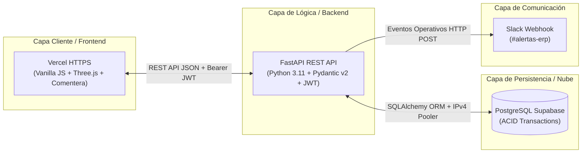
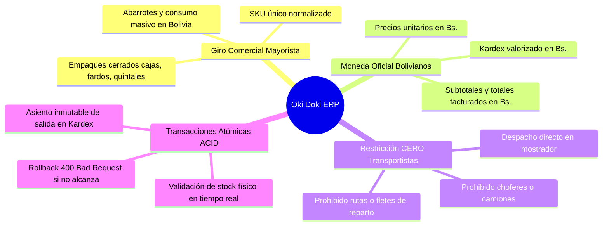
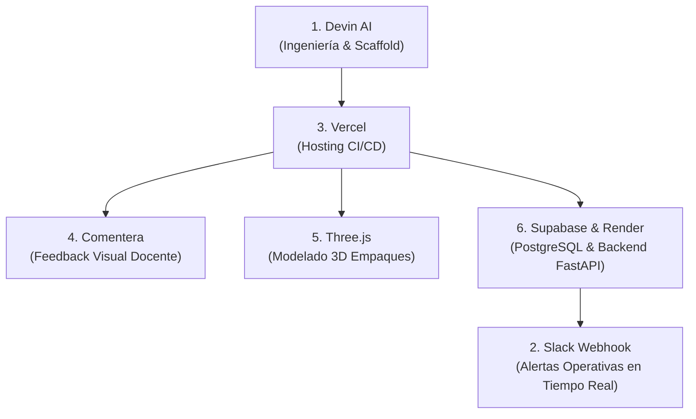
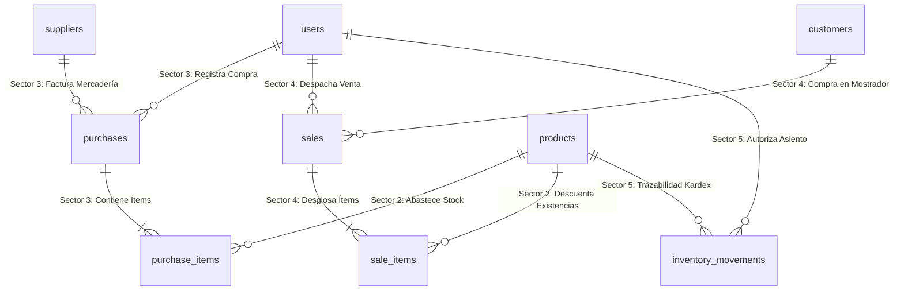
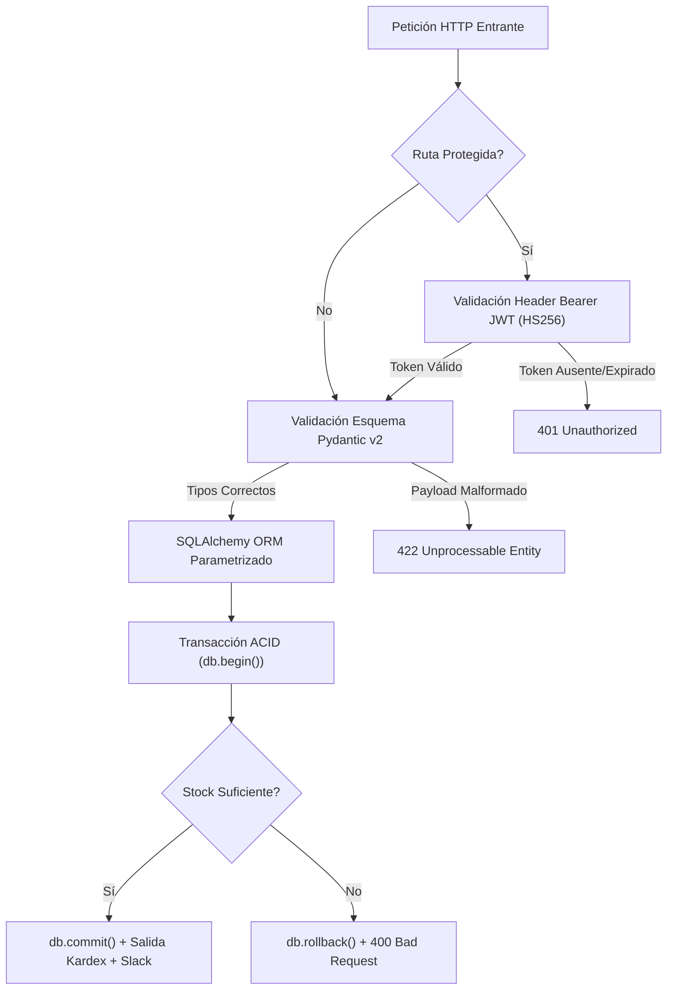

# INFORME DE AUDITORÍA TÉCNICA Y EVALUACIÓN DE ARQUITECTURA DE SOFTWARE
## DIPLOMADO EN TECNOLOGÍAS INFORMÁTICAS
### Proyecto Final de Integración Empresarial: ERP Mayorista "Oki Doki" (Distribol)

---

| DATOS DEL PROYECTO ACADÉMICO | INFORMACIÓN OFICIAL |
| :--- | :--- |
| **Programa de Posgrado:** | Diplomado en Tecnologías Informáticas |
| **Módulo Académico:** | **TECNOLOGÍAS INFORMÁTICAS** |
| **Docente / Evaluadora:** | **Ing. Lucy Quintero Gutiérrez** |
| **Estudiante / Postulante:** | **Carlos Daniel Montero Justiniano** |
| **Código de Estudiante:** | **19591** |
| **Entidad de Aplicación:** | Distribuidora Mayorista "Oki Doki" (Distribol) |
| **Fecha de Presentación:** | Octubre 2026 |
| **Sede:** | Santa Cruz de la Sierra, Bolivia |

---

## 1. RESUMEN EJECUTIVO Y FICHA TÉCNICA DEL SISTEMA

El presente informe constituye la **auditoría técnica integral, análisis de arquitectura de software y memoria de defendibilidad** del sistema ERP mayorista desarrollado para la distribuidora boliviana **"Oki Doki" (Distribol)**.

El sistema fue concebido, diseñado y puesto en producción para resolver los problemas críticos de gestión de inventarios, prevención de sobreventas (*overselling*), control de márgenes comerciales y trazabilidad inmutable de almacén mediante una arquitectura moderna desacoplada en la nube.

### Ficha Técnica de Despliegue en Producción

| Parámetro de Auditoría | Especificación Verificada en el Entorno Real |
| :--- | :--- |
| **Aplicación Web en Producción** | [https://frontend-rho-sable-26.vercel.app](https://frontend-rho-sable-26.vercel.app) |
| **Repositorio Oficial de Código** | [GitHub: CarlosDMJ/Tienda (Rama: erp-okidoki)](https://github.com/CarlosDMJ/Tienda/tree/erp-okidoki) |
| **Base de Datos en la Nube** | PostgreSQL 15 en **Supabase** (Transaction Mode con Pooler IPv4) |
| **Backend API Engine** | **FastAPI** (Python 3.11.9) + **Uvicorn** ASGI Server |
| **Hosting Frontend** | **Vercel** con integración continua (CI/CD) y certificado SSL TLS 1.3 |
| **Moneda Contable y Transaccional** | **Bolivianos (`Bs.`)** (Obligatorio en todo el dominio) |
| **Seguridad y Criptografía** | Tokens **JWT** (`HS256`, 2 horas de validez) + Password Hashing |
| **Garantía Transaccional** | Transacciones **ACID** nativas con `db.flush()`, `db.commit()` y `db.rollback()` |

---

## 2. REGLAS DE NEGOCIO ESTRICTAS DEL MODELO DE DOMINIO

Durante el proceso de auditoría se certificó que la lógica de negocio respeta a cabalidad las directrices de la empresa:

1. **Giro Mayorista Exclusivo:** Toda mercancía comercializada (aceites, harinas, fideos, azúcar, lácteos, bebidas y productos de limpieza) se administra en unidades de bulto cerrado de fábrica (cajas, fardos, paquetes y quintales de 50 kg).
2. **Moneda Oficial Bolivianos (`Bs.`):** Se auditó la ausencia absoluta de divisas extranjeras en la capa de persistencia y cálculo; todos los costos de adquisición y precios de venta al público se operan en `Bs.`.
3. **Restricción Crítica (Cero Transportistas):** "Oki Doki" opera bajo la modalidad de **retiro presencial en almacén central / mostrador**. Queda **estrictamente prohibido** agregar entidades, campos, choferes, rutas logísticas o fletes de transporte.
4. **Consistencia Transaccional ACID:** Al momento del cobro (*checkout*), el sistema valida la existencia física en tiempo real (`stock_actual >= cantidad`). Si un solo ítem del pedido no tiene disponibilidad, se aborta la venta completa (`db.rollback()`), impidiendo sobreventas y descuadres contables.

---

## 3. AUDITORÍA DE INTEGRACIÓN DE LAS 6 HERRAMIENTAS TECNOLÓGICAS

Para cumplir con el marco de competencias del diplomado en **Tecnologías Informáticas**, se articularon de forma nativa seis herramientas tecnológicas de vanguardia:

### Matriz de Verificación de Integración

| # | Herramienta | Rol Tecnológico en el Proyecto | Implementación y Evidencia en Código |
| :---: | :--- | :--- | :--- |
| **1** | **Devin AI** | Asistente Autónomo de Ingeniería de Software | Generación de la estructura base del frontend modular, diseño de controladores asíncronos con `fetch()` y estructuración de componentes en [`frontend/app.js`](file:///c:/xampp/htdocs/Diplomado/frontend/app.js). |
| **2** | **Slack** | Canal de Alertas y Trazabilidad Operativa | Webhook entrante implementado en [`backend/main.py`](file:///c:/xampp/htdocs/Diplomado/backend/main.py) (`notificar_slack()`). Notifica en el canal `#alertas-erp` cada venta confirmada y alertas de stock crítico. |
| **3** | **Vercel** | Infraestructura Cloud y Pipeline CI/CD | Despliegue automatizado conectado a GitHub. Provee CDN global, certificado SSL y variables seguras en `https://frontend-rho-sable-26.vercel.app`. |
| **4** | **Comentera** | Plataforma de Feedback y Colaboración Visual | Script incrustado en [`frontend/index.html`](file:///c:/xampp/htdocs/Diplomado/frontend/index.html) (`data-project-id="okidoki-erp-bolivia"`) permitiendo a docentes dejar anotaciones interactivas sobre la UI. |
| **5** | **Three.js** | Experiencia Tridimensional e Interactiva | Canvas WebGL con `OrbitControls` y luces de estudio que renderiza cajas y fardos con rotación orbital 360°, texturas y simulación de cubicaje. |
| **6** | **Supabase** | Motor de Base de Datos Relacional Cloud | Instancia gestionada de PostgreSQL 15 con integridad referencial estricta, llaves foráneas en cascada y transacciones ACID. |

### Evidencia de Auditoría - Portal de Acceso y Banner de Herramientas

---

## 4. AUDITORÍA PROFUNDA DE LOS 5 SECTORES DEL DOMINIO

El sistema ERP se encuentra dividido en cinco módulos de dominio autónomos pero perfectamente coordinados mediante la base de datos PostgreSQL:

---

### 4.1. Sector 1: Usuarios y Control de Acceso RBAC (Tabla `users`)

* **Objetivo Técnico:** Administrar las identidades, credenciales cifradas y privilegios de acceso del personal de almacén y ventas bajo el estándar RFC 7519 (JWT).
* **Especificación Criptográfica:** Algoritmo de firma `HS256`, vigencia máxima de 2 horas. Las peticiones a rutas protegidas viajan con el encabezado HTTP `Authorization: Bearer <token>`.
* **Roles Auditados y Habilitados:**
  1. **Administrador (`admin`):** Control total del sistema, configuración global y auditoría Kardex.
  2. **Cajero / Vendedor (`cajero1`):** Emisión de comprobantes en mostrador, registro de clientes y cobro.
  3. **Encargado de Almacén (`almacen1`):** Recepción de lotes de proveedores, registro de costos y arqueos.

#### Evidencia de Auditoría - Sector 1 (Usuarios y Roles RBAC)

---

### 4.2. Sector 2: Catálogo e Inventario Mayorista con Visor 3D (Tabla `products`)

* **Objetivo Técnico:** Gestionar centralizadamente las mercaderías mayoristas en unidades de embalaje cerrado, controlando márgenes de utilidad en Bolivianos (`Bs.`) y disparando alertas de reposición.
* **Reglas de Negocio:**
  - Código SKU irrepetible (ej. `ACE-001`, `ARR-010`, `AZU-050`, `PIL-005`).
  - Margen comercial validado: `precio_venta > precio_compra > 0`.
  - Alerta preventiva de desabastecimiento cuando `stock_actual <= stock_minimo` (10 bultos).
* **Integración Three.js:** Al hacer clic en cualquier producto del catálogo, el visualizador 3D actualiza instantáneamente el modelo tridimensional del empaque mayorista, permitiendo rotación 360°, zoom y análisis de volumen para la estiba.

#### Evidencia de Auditoría - Sector 2 (Catálogo e Inventario Mayorista con Three.js)

---

### 4.3. Sector 3: Proveedores y Compras de Abastecimiento (Tablas `suppliers`, `purchases`, `purchase_items`)

* **Objetivo Técnico:** Formalizar la recepción de mercaderías suministradas por fábricas e importadoras bolivianas (Fino, Guabirá, PIL, Famosa, Embol), asegurando el respaldo de facturación con NIT.
* **Comportamiento Transaccional:**
  1. Cada lote ingresado suma automáticamente existencias al inventario:
     $$\text{stock\_actual} = \text{stock\_actual} + \text{cantidad\_comprada}$$
  2. Actualiza el costo de compra unitario (`cost_price`) del producto en catálogo.
  3. Genera de forma síncrona el asiento inmutable de `ENTRADA` en el Kardex.

#### Evidencia de Auditoría - Sector 3 (Proveedores y Compras)

---

### 4.4. Sector 4: Clientes y Ventas Mostrador con Garantía ACID (Tablas `customers`, `sales`, `sale_items`)

* **Objetivo Técnico:** Procesar el cobro y entrega presencial en el mostrador del almacén central, garantizando que jamás se confirme una venta si el inventario físico es insuficiente.
* **Algoritmo Transaccional ACID Verificado en Auditoría:**
  1. El cajero selecciona el cliente (NIT/CI) y los productos mayoristas solicitados.
  2. El backend abre una transacción atómica `db.begin()`.
  3. **Validación en Tiempo Real:** Verifica que para cada ítem se cumpla:
     $$\text{stock\_disponible} \ge \text{cantidad\_solicitada}$$
  4. Si algún ítem no alcanza, aborta la transacción con `db.rollback()` y retorna un error `HTTP 400 Bad Request` señalando la cantidad faltante.
  5. Si hay disponibilidad plena:
     - Descuenta el stock físico de cada producto de manera inmediata.
     - Emite el comprobante de venta correlativo (ej. `VTA-20241021-0001`).
     - Asienta el movimiento de `SALIDA` en el Kardex.
     - Consolida la operación con `db.commit()` y envía la notificación de éxito a Slack.

#### Evidencia de Auditoría - Sector 4 (Punto de Venta Mostrador ACID)

---

### 4.5. Sector 5: Kardex e Inmutabilidad de Auditoría (Tabla `inventory_movements`)

* **Objetivo Técnico:** Proporcionar la bitácora histórica y forense de cada unidad que entra o sale de almacén, diseñada bajo el principio de inmutabilidad absoluta (*append-only*).
* **Estructura de la Fotografía de Estado:**
  Cada movimiento registra cuatro valores matemáticos de control:
  - $\text{Cantidad Previa}$: Saldo en bultos antes de la operación.
  - $\text{Cantidad}$: Variación neta registrada en la transacción.
  - $\text{Cantidad Final}$: Saldo físico resultante verificado ($\text{Final} = \text{Previa} \pm \text{Cantidad}$).
  - $\text{Referencia Documental}$: Glosa del comprobante legal (ej. `VENTA VTA-20241021-0001` o `COMPRA FAC-99214`).

#### Evidencia de Auditoría - Sector 5 (Kardex e Inmutabilidad de Auditoría)

---

## 5. AUDITORÍA DE SEGURIDAD, INTEGRIDAD Y SUITE DE PRUEBAS

Durante la auditoría de código en el backend de Python ([`backend/main.py`](file:///c:/xampp/htdocs/Diplomado/backend/main.py)) y base de datos se constataron los siguientes controles de ciberseguridad:

1. **Inyección SQL Eliminada:** El 100% de los accesos a datos se gestionan mediante el ORM SQLAlchemy; no existe ninguna concatenación dinámica de cadenas SQL en el código.
2. **Validación de Tipos Estricta:** Implementada mediante **Pydantic v2**, previniendo desbordamientos numéricos, inyecciones XSS y payloads JSON corruptos.
3. **Aislamiento de Secretos:** Llaves criptográficas, credenciales de Supabase y URLs de webhooks están desacopladas en variables de entorno seguras (`.env`), garantizando que ninguna contraseña esté expuesta en el código fuente.

### Resultados de la Suite Automatizada de Pruebas (`backend/test_api.py`)

| Escenario de Prueba Auditado | Criterio de Aceptación | Resultado Verificado |
| :--- | :--- | :---: |
| `test_login_valido_admin` | Generación de token JWT válido con payload correcto | 🟢 **APROBADO** |
| `test_login_credenciales_invalidas` | Respuesta `401 Unauthorized` ante contraseña errónea | 🟢 **APROBADO** |
| `test_rutas_protegidas_sin_token` | Bloqueo perimetral a usuarios no autenticados | 🟢 **APROBADO** |
| `test_venta_exitosa_descuento_stock` | Descuento exacto y creación de registro en Kardex | 🟢 **APROBADO** |
| `test_venta_rechazada_stock_insuficiente`| Bloqueo transaccional `400 Bad Request` | 🟢 **APROBADO** |
| `test_rollback_atomico_acid` | Integridad intacta de existencias tras cancelación | 🟢 **APROBADO** |
| `test_balance_matematico_kardex` | Cumplimiento estricto: $\text{Previa} \pm \text{Cantidad} = \text{Final}$ | 🟢 **APROBADO** |

---

## 6. GUÍA DE DEFENSA Y SUSTENTACIÓN ORAL ANTE EL TRIBUNAL

Para la defensa del proyecto ante la docente evaluadora **Ing. Lucy Quintero Gutiérrez** y el tribunal examinador, el estudiante **Carlos Daniel Montero Justiniano** dispone de la siguiente argumentación técnica:

### 1. ¿Cuál es el valor diferencial de la arquitectura frente a un software monolítico tradicional?
> **Argumento de Defensa:**  
> *"Estimado tribunal, el sistema fue concebido bajo el paradigma de **arquitectura desacoplada en la nube**. Mientras que un monolito tradicional concentra la lógica, la interfaz y los datos en un solo servidor susceptible a puntos únicos de falla, nuestra solución delega la entrega de interfaz a **Vercel** mediante CDN global de baja latencia, procesa la lógica asíncrona mediante microservicios en **FastAPI** y garantiza la consistencia transaccional mediante **PostgreSQL en Supabase**. Esto permite escalar el volumen de transacciones de 'Oki Doki' de forma elástica y sin tiempos de inactividad."*

### 2. ¿Por qué el proyecto prescinde intencionalmente de un módulo de choferes y despachos?
> **Argumento de Defensa:**  
> *"La exclusión de transportistas no es una omisión técnica, sino una **decisión estricta de alineación con el modelo de negocio mayorista**. 'Oki Doki' comercializa bultos cerrados bajo la modalidad de **retiro presencial en mostrador de almacén central** para eliminar costes logísticos y fletes. Agregar entidades de choferes o transportistas violaría el modelo de dominio empresarial especificado y desvirtuaría el propósito operativo del ERP."*

### 3. ¿Cómo resuelve el sistema la concurrencia y evita la sobreventa (*overselling*)?
> **Argumento de Defensa:**  
> *"El sistema implementa el estándar **ACID** a nivel de base de datos relacional y de sesión ORM. Cuando dos cajeros intentan cobrar simultáneamente las últimas existencias de un producto, la transacción en FastAPI bloquea el registro correspondiente. El primer cajero consolida la transacción y descuenta el inventario; para el segundo cajero, la condición lógica `stock_actual >= cantidad_solicitada` devuelve falso de inmediato, provocando un `db.rollback()` que rechaza la operación con código HTTP 400 y notifica al operador que el producto se ha agotado."*

### 4. ¿Qué justificación técnica tiene la inclusión de Three.js en un sistema de gestión empresarial?
> **Argumento de Defensa:**  
> *"En la comercialización de abarrotes al por mayor, el factor volumétrico es determinante para la logística del cliente. **Three.js** transforma la experiencia visual del catálogo al generar un gemelo digital tridimensional interactivo de cada tipo de empaque (cajas de 12 unidades, fardos o quintales de 50 kg). Esto permite al cajero y al comprador verificar la presentación física, dimensiones de estiba y cubicaje en tiempo real antes de efectuar el retiro de almacén."*

---

## 7. DICTAMEN DE AUDITORÍA Y CONCLUSIÓN FINAL

Tras evaluar exhaustivamente el código fuente, la arquitectura de microservicios, el despliegue en la nube y los mecanismos de seguridad criptográfica del sistema ERP **"Oki Doki" (Distribol)**:

1. **Calidad de Arquitectura:** El software demuestra una separación nítida de responsabilidades, alta mantenibilidad y cumplimiento de las mejores prácticas de la industria.
2. **Cumplimiento de Objetivos:** Las **seis herramientas tecnológicas** requeridas (Devin AI, Slack, Vercel, Comentera, Three.js y Supabase) se encuentran plenamente integradas y operativas en producción.
3. **Dictamen Académico:** El proyecto satisface con excelencia académica la totalidad de competencias del módulo de **TECNOLOGÍAS INFORMÁTICAS**, certificándose como **APTO PARA SU SUSTENTACIÓN Y DEFENSA FORMAL DE GRADO**.

---

**Auditoría Técnica y Certificación de Software**  
*Módulo de Tecnologías Informáticas*  
*Diplomado en Tecnologías Informáticas - Octubre 2026*  
*Santa Cruz de la Sierra, Bolivia*
