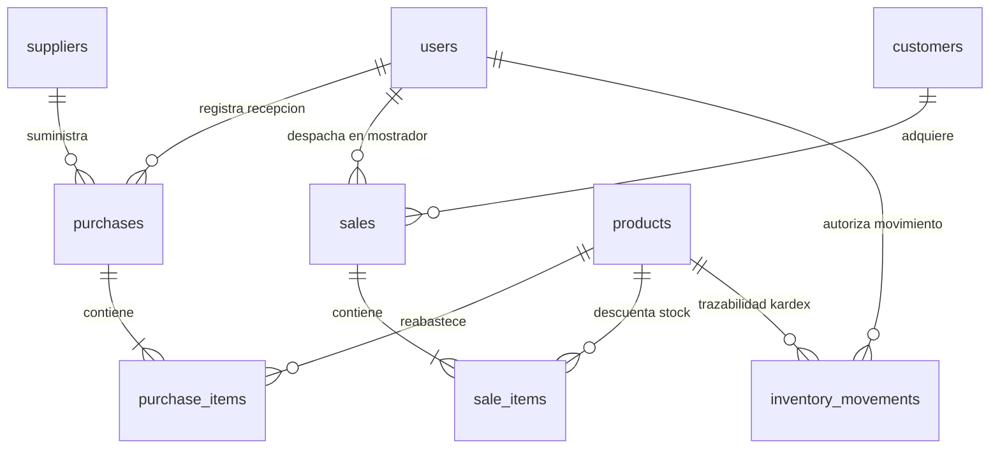

# SISTEMA ERP MAYORISTA "OKI DOKI" (DISTRIBOL)
## PRÁCTICA DE INTEGRACIÓN EMPRESARIAL - DIPLOMADO FULL-STACK
### Documento de Arquitectura y Especificación de Datos

---

# 2. Modelo de Dominio Mínimo (Las 5 Entidades Base)

El presente modelo de dominio define la arquitectura técnica y funcional del Producto Mínimo Viable (MVP) de Compra-Venta e Inventario para la distribuidora comercial mayorista **"Oki Doki" (Distribol)**, desarrollado con **FastAPI**, **SQLAlchemy ORM** y **PostgreSQL (Supabase)**, con soporte para transacciones atómicas (ACID) y respaldo local SQLite.

### Reglas de Negocio Estrictas de "Oki Doki":
1. **Rubro de Operación:** Distribuidora mayorista de productos de consumo masivo y abarrotes en Bolivia (aceites, arroz, fideos, azúcar, lácteos, bebidas y limpieza), comercializados exclusivamente en unidades de embalaje cerradas (cajas, fardos, paquetes y quintales con código SKU único).
2. **Moneda Oficial:** Bolivianos (`Bs.`). Todos los costos, precios mayoristas, subtotales, totales facturados y movimientos de Kardex se calculan y presentan obligatoriamente en `Bs.`.
3. **Restricción Crítica (Cero Transportistas):** La distribuidora **NO cuenta con personal de reparto ni flota de transporte externa**. Queda **estrictamente prohibido** agregar roles de chofer, tablas de envíos, rutas de distribución, transportistas o comisiones por entrega. Toda operación de compra (recepción de proveedores) y venta (retiro de clientes) se realiza de forma directa y presencial en el almacén central o sucursal.
4. **Transacciones Atómicas (ACID) y Descuento en Tiempo Real:** Al procesar una venta (`checkout`), el backend valida la disponibilidad física de cada ítem (`stock_actual >= cantidad_solicitada`), descuenta las unidades de forma inmediata y persiste la cabecera y el detalle en una sola transacción lógica (`db.flush()`, `db.commit()`). En caso de insuficiencia o error, se ejecuta `db.rollback()` de manera automática, garantizando la inmutabilidad y consistencia del inventario.

---

### Diagrama Entidad-Relación Conceptual

---

## 2.1. Módulo de Usuarios y Roles (Tabla: `users`)

### 1. Nombre y Objetivo del Módulo
* **Nombre del Módulo:** Módulo de Usuarios y Roles.
* **Objetivo:** Gestionar la identidad, credenciales de seguridad y el control de acceso basado en roles (RBAC) mediante tokens criptográficos JWT (algoritmo HS256 con expiración de 2 horas), restringiendo y protegiendo la ejecución de operaciones críticas en almacén y mostrador.

### 2. Funcionalidades Principales y Reglas de Negocio
* **Autenticación Centralizada:** Generación y verificación de tokens `Bearer <token>` para rutas protegidas.
* **Restricción RBAC según los 3 Roles Exclusivos de Oki Doki:**
  * **Administrador:** Acceso total al sistema, catálogo de productos, compras, reportes consolidados y bitácora de auditoría.
  * **Cajero/Vendedor:** Atención directa en mostrador de sucursal, consulta pública de existencias, armado de pedidos de venta y facturación con descuento en tiempo real.
  * **Encargado de Almacén:** Recepción de lotes de mercadería de proveedores, control de umbrales de stock mínimo y registro de ajustes físicos de inventario.
* **Seguridad:** Cifrado hash de contraseñas y validación de usuarios activos.

### 3. Descripción Exacta de los Campos (Tabla: `users`)
Formato de especificación técnica:
* `IdUsuario => int (Llave primaria PK, autoincremental, identificador único del usuario en el sistema)`
* `nombre_completo => string (VARCHAR(100), not null, nombres y apellidos del empleado u operador)`
* `username => string (VARCHAR(50), unique, not null, index, nombre de usuario único para inicio de sesión)`
* `email => string (VARCHAR(100), unique, not null, dirección de correo electrónico corporativo)`
* `password_hash => string (VARCHAR(255), not null, hash seguro o contraseña cifrada para autenticación)`
* `rol => string (VARCHAR(30), not null, rol asignado: 'Administrador' | 'Cajero/Vendedor' | 'Encargado de Almacén')`
* `activo => boolean (BOOLEAN, not null, default true, indicador de vigencia y habilitación operativa)`
* `fecha_creacion => datetime (TIMESTAMP / DATETIME, not null, default utcnow, fecha y hora de registro)`

| Campo | Tipo de Dato | Restricciones | Descripción |
| :--- | :--- | :--- | :--- |
| `IdUsuario` | `int` | PK, Auto | Identificador único de operador. |
| `nombre_completo` | `string` | NOT NULL | Nombre y apellidos del empleado. |
| `username` | `string` | UNIQUE, NOT NULL, INDEX | Usuario de acceso al sistema. |
| `email` | `string` | UNIQUE, NOT NULL | Correo corporativo. |
| `password_hash` | `string` | NOT NULL | Hash cifrado de contraseña. |
| `rol` | `string` | NOT NULL | `'Administrador'`, `'Cajero/Vendedor'` o `'Encargado de Almacén'`. |
| `activo` | `boolean` | NOT NULL, DEFAULT TRUE | Estado operativo de la cuenta. |
| `fecha_creacion` | `datetime` | NOT NULL, DEFAULT UTC | Fecha y hora de alta en el sistema. |

---

## 2.2. Módulo de Catálogo e Inventario de Productos (Tabla: `products`)

### 1. Nombre y Objetivo del Módulo
* **Nombre del Módulo:** Módulo de Catálogo e Inventario de Productos.
* **Objetivo:** Administrar centralizadamente las mercaderías mayoristas de consumo masivo de "Oki Doki", monitoreando las existencias físicas en tiempo real en unidades de embalaje cerradas (cajas, fardos, paquetes, quintales) y controlando los márgenes de comercialización en Bolivianos (Bs.).

### 2. Funcionalidades Principales y Reglas de Negocio
* **Identificación por SKU Único:** Código de barras o identificador alfanumérico irrepetible (ej. `ACE-001`, `ARR-010`, `AZU-050`).
* **Control de Márgenes de Comercialización:** Mantiene la relación obligatoria `precio_venta > precio_compra > 0` expresada en Bolivianos (Bs.).
* **Alerta Automática de Reabastecimiento:** Notificación visual y bloqueo de prevención cuando `stock_actual <= stock_minimo`, evitando quiebres de inventario.
* **Unidad Mayorista:** Las existencias representan bultos cerrados de distribución comercial (cajas, fardos o quintales).

### 3. Descripción Exacta de los Campos (Tabla: `products`)
Formato de especificación técnica:
* `IdProducto => int (Llave primaria PK, autoincremental, identificador único del producto mayorista)`
* `codigo_sku => string (VARCHAR(50), unique, not null, index, código SKU estandarizado e irrepetible)`
* `nombre => string (VARCHAR(150), not null, descripción comercial y empaque mayorista ej. Caja de Aceite Fino 1L 12 uds)`
* `precio_compra => float/decimal (DECIMAL(10,2) / Float, not null, valor >= 0, costo mayorista de adquisición en Bs.)`
* `precio_venta => float/decimal (DECIMAL(10,2) / Float, not null, valor > 0, precio mayorista de venta al mostrador en Bs.)`
* `stock_actual => int (INTEGER, not null, valor >= 0, default 0, existencias físicas disponibles en almacén en cajas o fardos)`
* `stock_minimo => int (INTEGER, not null, valor >= 0, default 10, umbral de seguridad para emitir alerta de reposición)`

| Campo | Tipo de Dato | Restricciones | Descripción |
| :--- | :--- | :--- | :--- |
| `IdProducto` | `int` | PK, Auto | Identificador único de mercadería. |
| `codigo_sku` | `string` | UNIQUE, NOT NULL, INDEX | Código SKU mayorista único. |
| `nombre` | `string` | NOT NULL | Nombre y presentación en caja/fardo. |
| `precio_compra` | `float/decimal` | NOT NULL, >= 0 | Costo de adquisición mayorista en Bs. |
| `precio_venta` | `float/decimal` | NOT NULL, > 0 | Precio de venta en mostrador en Bs. |
| `stock_actual` | `int` | NOT NULL, >= 0, DEFAULT 0 | Existencia física disponible en almacén. |
| `stock_minimo` | `int` | NOT NULL, >= 0, DEFAULT 10 | Umbral para alerta de desabastecimiento. |

---

## 2.3. Módulo de Proveedores y Compras (Tablas: `suppliers`, `purchases` y `purchase_items`)

### 1. Nombre y Objetivo del Módulo
* **Nombre del Módulo:** Módulo de Proveedores y Compras.
* **Objetivo:** Gestionar el abastecimiento mayorista de mercaderías e ingresos formales al almacén central de Oki Doki procedentes de proveedores e industrias fabricantes, asegurando el incremento de existencias y la trazabilidad de costos.

### 2. Funcionalidades Principales y Reglas de Negocio
* **Recepción de Facturas/Notas de Entrega:** Registro documental de compras vinculadas al proveedor y al operador de almacén receptor.
* **Incremento Automático de Stock:** Cada compra confirmada suma de inmediato las cantidades al inventario físico: `stock_actual = stock_actual + cantidad_comprada`.
* **Actualización del Costo de Compra:** Actualiza el `precio_compra` del producto de acuerdo al último costo pactado.
* **Impacto Inmediato en Kardex:** Genera automáticamente un movimiento inmutable de `ENTRADA` por cada ítem recibido.

### 3. Descripción Exacta de los Campos

#### A. Tabla `suppliers` (Proveedores Mayoristas)
* `IdProveedor => int (Llave primaria PK, autoincremental, código único del proveedor)`
* `razon_social => string (VARCHAR(120), not null, denominación comercial o razón social de la empresa fabricante o importadora)`
* `nit => string (VARCHAR(30), unique, not null, Número de Identificación Tributaria del proveedor en Bolivia)`
* `telefono => string (VARCHAR(20), nullable, teléfono fijo o celular de contacto comercial)`
* `email => string (VARCHAR(100), nullable, correo electrónico de pedidos y facturación)`
* `direccion => string (VARCHAR(200), nullable, domicilio legal, planta industrial o centro de distribución)`
* `activo => boolean (BOOLEAN, not null, default true, estado operativo del proveedor)`

#### B. Tabla `purchases` (Cabecera de Compras)
* `IdCompra => int (Llave primaria PK, autoincremental, identificador único de la transacción de compra)`
* `numero_factura => string (VARCHAR(50), nullable, número de factura fiscal o nota de entrega del proveedor)`
* `IdProveedor => int (Llave foránea FK hacia suppliers.IdProveedor, not null, empresa proveedora que suministra el lote)`
* `IdUsuario => int (Llave foránea FK hacia users.IdUsuario, not null, operador de almacén que recepcionó la mercadería)`
* `total_compra => float/decimal (DECIMAL(12,2) / Float, not null, valor >= 0, importe total liquidado en Bolivianos Bs.)`
* `fecha_compra => datetime (TIMESTAMP / DATETIME, not null, default utcnow, fecha y hora de recepción en almacén)`

#### C. Tabla `purchase_items` (Detalle de Ítems Comprados)
* `IdDetalleCompra => int (Llave primaria PK, autoincremental, identificador único del ítem recibido)`
* `IdCompra => int (Llave foránea FK hacia purchases.IdCompra, not null, on delete cascade, vínculo con la cabecera de compra)`
* `IdProducto => int (Llave foránea FK hacia products.IdProducto, not null, producto reabastecido en almacén)`
* `cantidad => int (INTEGER, not null, valor > 0, cantidad de cajas, fardos o paquetes ingresados físicamente)`
* `precio_unitario => float/decimal (DECIMAL(10,2) / Float, not null, valor > 0, costo de compra unitario pactado en Bs.)`
* `subtotal => float/decimal (DECIMAL(12,2) / Float, not null, valor > 0, subtotal liquidado en Bs. cantidad * precio_unitario)`

---

## 2.4. Módulo de Clientes y Ventas (Tablas: `customers`, `sales` y `sale_items`)

### 1. Nombre y Objetivo del Módulo
* **Nombre del Módulo:** Módulo de Clientes y Ventas (Punto de Venta Mayorista).
* **Objetivo:** Ejecutar la venta y despacho directo de mercadería en mostrador bajo transacciones atómicas (ACID) en FastAPI, garantizando que el stock físico se valide y descuente en tiempo real sin descuadres ni sobreventas.

### 2. Funcionalidades Principales y Reglas de Negocio
* **Validación Previa de Stock en Tiempo Real:** Para cada ítem solicitado, el backend comprueba estrictamente: `stock_actual >= cantidad_solicitada`.
* **Reversión Automática (Rollback ACID):** Si cualquier producto solicitado carece de existencias, la transacción completa se anula con código `400 Bad Request` indicando el faltante y ejecutando `db.rollback()`. Ningún ítem se descuenta si la orden no puede satisfacerse íntegramente.
* **Descuento Inmediato de Unidades:** Con disponibilidad confirmada, descuenta en tiempo real (`stock_actual = stock_actual - cantidad_vendida`), emite el comprobante de salida correlativo (ej. `VTA-20241021-0001`), calcula totales en Bolivianos (`Bs.`) y genera el asiento de `SALIDA` en el Kardex.
* **Venta en Mostrador:** El cliente retira el pedido directamente en sucursal (cero logística de despacho externo).

### 3. Descripción Exacta de los Campos

#### A. Tabla `customers` (Clientes Mayoristas)
* `IdCliente => int (Llave primaria PK, autoincremental, identificador único del cliente mayorista)`
* `nombre_razon_social => string (VARCHAR(120), not null, nombre del comerciante o razón social de la tienda minorista)`
* `nit_ci => string (VARCHAR(30), not null, index, NIT o Carnet de Identidad para emisión del comprobante en Bolivia)`
* `telefono => string (VARCHAR(20), nullable, teléfono fijo o celular de contacto)`
* `tipo_cliente => string (VARCHAR(30), not null, default 'Mayorista Mostrador', modalidad comercial de atención)`
* `activo => boolean (BOOLEAN, not null, default true, estado comercial del cliente)`

#### B. Tabla `sales` (Cabecera de Ventas / Comprobantes)
* `IdVenta => int (Llave primaria PK, autoincremental, identificador único de la transacción de venta)`
* `codigo_comprobante => string (VARCHAR(50), unique, not null, index, numeración correlativa única ej. VTA-YYYYMMDD-XXXX)`
* `IdCliente => int (Llave foránea FK hacia customers.IdCliente, nullable, cliente mayorista o venta rápida de mostrador)`
* `IdUsuario => int (Llave foránea FK hacia users.IdUsuario, not null, cajero o vendedor que despachó el pedido)`
* `total_venta => float/decimal (DECIMAL(12,2) / Float, not null, valor >= 0, importe total cobrado en mostrador en Bolivianos Bs.)`
* `fecha_venta => datetime (TIMESTAMP / DATETIME, not null, default utcnow, fecha y hora de emisión del comprobante)`

#### C. Tabla `sale_items` (Detalle de Ítems Vendidos)
* `IdDetalleVenta => int (Llave primaria PK, autoincremental, identificador único del ítem despachado)`
* `IdVenta => int (Llave foránea FK hacia sales.IdVenta, not null, on delete cascade, vínculo con la cabecera de venta)`
* `IdProducto => int (Llave foránea FK hacia products.IdProducto, not null, producto entregado al cliente)`
* `cantidad => int (INTEGER, not null, valor > 0, cantidad de cajas, fardos o paquetes entregados en mostrador)`
* `precio_unitario => float/decimal (DECIMAL(10,2) / Float, not null, valor > 0, precio de venta mayorista cobrado en Bs.)`
* `subtotal => float/decimal (DECIMAL(12,2) / Float, not null, valor > 0, subtotal liquidado en Bs. cantidad * precio_unitario)`

---

## 2.5. Módulo de Kardex / Movimientos de Inventario (Tabla: `inventory_movements`)

### 1. Nombre y Objetivo del Módulo
* **Nombre del Módulo:** Módulo de Kardex / Movimientos de Inventario.
* **Objetivo:** Constituir la bitácora inmutable de auditoría y trazabilidad histórica de cada unidad física que ingresa o sale del almacén de Oki Doki, garantizando el control patrimonial de existencias ante cualquier inspección o arqueo físico.

### 2. Funcionalidades Principales y Reglas de Negocio
* **Inmutabilidad Absoluta:** Asientos de solo inserción (*append-only*); ningún movimiento puede ser modificado ni eliminado una vez registrado.
* **Fotografía de Estado (Auditoría Forense):** Registra de manera simultánea:
  * `cantidad_previa`: Existencias físicas en almacén antes del movimiento.
  * `cantidad`: Variación neta de cajas o fardos involucrados.
  * `cantidad_final`: Existencias físicas resultantes tras la operación (`cantidad_final = cantidad_previa ± cantidad`).
* **Tipología de Movimiento:**
  * `ENTRADA`: Originada por el Módulo de Compras (ingreso de lotes de proveedores).
  * `SALIDA`: Originada por el Módulo de Ventas (despacho en mostrador con checkout ACID).
  * `AJUSTE`: Originada por conteos físicos de almacén, roturas o mermas autorizadas por el Encargado de Almacén.

### 3. Descripción Exacta de los Campos (Tabla: `inventory_movements`)
Formato de especificación técnica:
* `IdMovimiento => int (Llave primaria PK, autoincremental, identificador correlativo del asiento inmutable de Kardex)`
* `IdProducto => int (Llave foránea FK hacia products.IdProducto, not null, producto objeto del movimiento físico)`
* `IdUsuario => int (Llave foránea FK hacia users.IdUsuario, not null, operador o cajero responsable del movimiento)`
* `tipo_movimiento => string (VARCHAR(20), not null, tipo de operación: 'ENTRADA' | 'SALIDA' | 'AJUSTE')`
* `cantidad => int (INTEGER, not null, valor > 0, número de cajas o fardos sujetos a la variación)`
* `cantidad_previa => int (INTEGER, not null, valor >= 0, saldo físico existente inmediatamente antes de la transacción)`
* `cantidad_final => int (INTEGER, not null, valor >= 0, saldo físico resultante en almacén tras la operación)`
* `referencia_documento => string (VARCHAR(100), not null, glosa o documento mercantil de respaldo ej. VENTA VTA-20241021-0001 o COMPRA FAC-88412)`
* `fecha_movimiento => datetime (TIMESTAMP / DATETIME, not null, default utcnow, marca temporal exacta del movimiento)`

| Campo | Tipo de Dato | Restricciones | Descripción |
| :--- | :--- | :--- | :--- |
| `IdMovimiento` | `int` | PK, Auto | Asiento correlativo inmutable de Kardex. |
| `IdProducto` | `int` | FK -> `products.IdProducto`, NOT NULL | Producto objeto del movimiento físico. |
| `IdUsuario` | `int` | FK -> `users.IdUsuario`, NOT NULL | Operador responsable que originó el registro. |
| `tipo_movimiento` | `string` | NOT NULL | `'ENTRADA'`, `'SALIDA'` o `'AJUSTE'`. |
| `cantidad` | `int` | NOT NULL, > 0 | Unidades físicas (cajas/fardos) del movimiento. |
| `cantidad_previa` | `int` | NOT NULL, >= 0 | Stock físico antes de la transacción. |
| `cantidad_final` | `int` | NOT NULL, >= 0 | Stock físico resultante tras la transacción. |
| `referencia_documento` | `string` | NOT NULL | Comprobante mercantil de respaldo. |
| `fecha_movimiento` | `datetime` | NOT NULL, DEFAULT UTC | Fecha y hora exacta de ejecución. |

---

## 2.6. Matriz de Coherencia y Trazabilidad con el Código del Backend

| Entidad / Tabla | Modelo SQLAlchemy (`backend/models.py`) | Esquema Pydantic (`backend/schemas.py`) | Endpoints REST Vinculados (`backend/main.py`) |
| :--- | :--- | :--- | :--- |
| `users` | `class User(Base)` | `LoginRequest`, `TokenResponse` | `POST /api/v1/auth/login` |
| `products` | `class Product(Base)` | `ProductBase`, `ProductCreate`, `ProductOut` | `GET /api/v1/products` `POST /api/v1/products` |
| `suppliers` `purchases` `purchase_items` | `class Supplier(Base)` `class Purchase(Base)` `class PurchaseItem(Base)` | `CompraCreate`, `CompraResponse` | `POST /api/v1/compras` `GET /api/v1/compras` |
| `customers` `sales` `sale_items` | `class Customer(Base)` `class Sale(Base)` `class SaleItem(Base)` | `SaleCreate`, `SaleItemCreate`, `SaleOut` | `POST /api/v1/sales/checkout` `GET /api/v1/sales` |
| `inventory_movements` | `class InventoryMovement(Base)` | `KardexMovementOut` | Disparado automáticamente en `checkout` y `compras` |
