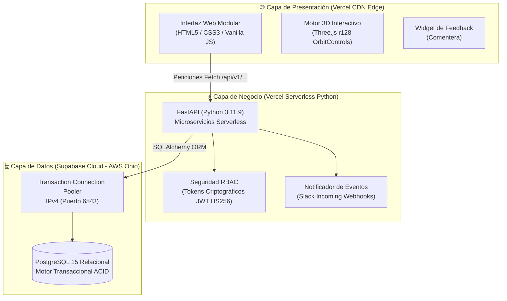

# 🏢 Sistema ERP Mayorista "Oki Doki" (Distribol)
> **Proyecto Final de Integración Tecnológica Empresarial • Diplomado en Tecnologías Informáticas**  
> **Docente Evaluadora:** Ing. Lucy Quintero Gutiérrez  
> **Estudiante:** Carlos Daniel Montero Justiniano • **Código:** 19591  
> **Sede:** Santa Cruz de la Sierra, Bolivia • **Gestión:** Octubre 2026  

---

## 🌐 Enlaces Oficiales en Producción (Cloud 24/7)

| Recurso | Enlace Directo | Estado |
| :--- | :--- | :---: |
| **🚀 Aplicación Web ERP (Producción):** | [https://okidoki-erp.vercel.app](https://okidoki-erp.vercel.app) *(alias: [okidoki-distribol.vercel.app](https://okidoki-distribol.vercel.app))* |  |
| **📊 Diapositivas de Grado (20 Slides):** | [https://okidoki-erp.vercel.app/presentacion_defensa.html](https://okidoki-erp.vercel.app/presentacion_defensa.html) |  |
| **⚡ API REST Backend (FastAPI + Supabase):** | [https://okidoki-erp.vercel.app/api/v1/products](https://okidoki-erp.vercel.app/api/v1/products) |  |
| **🗄️ Base de Datos Relacional Cloud:** | `aws-0-us-east-2.pooler.supabase.com:6543` |  |

---

## 🏛️ Arquitectura Desacoplada en la Nube



---

## 🛠️ Matriz de las 6 Herramientas Tecnológicas

| # | Herramienta | Rol en la Solución | Implementación Técnica |
| :-: | :--- | :--- | :--- |
| **1** | **Devin AI** | Ingeniería de Software y Aceleración | Scaffolding de código limpio, contratos de interfaz y controladores modulares. |
| **2** | **Slack** | Observabilidad y Alertas Operativas | Notificaciones automáticas a gerencia por cada venta y alerta de stock mínimo. |
| **3** | **Vercel** | Hosting CDN y Backend Serverless | Entrega con SSL TLS 1.3 y ejecución elástica de FastAPI vía `@vercel/python`. |
| **4** | **Comentera** | Auditoría y Feedback Visual | Widget colaborativo docente integrado en `index.html` con fallback modal. |
| **5** | **Three.js** | Experiencia Visual y Cubicaje 3D | Renderizado WebGL de cajas, fardos y quintales con rotación orbital 360°. |
| **6** | **Supabase** | Motor de Base de Datos Relacional | Base de datos PostgreSQL alojada en AWS con soporte ACID y Pooler de conexiones. |

---

## 📦 Los 5 Sectores del Modelo de Dominio

1. **Sector 1 — Usuarios y Acceso RBAC (`users`):** Control de acceso por roles (*Administrador*, *Cajero/Vendedor*, *Encargado de Almacén*) con tokens JWT de 2 horas.
2. **Sector 2 — Catálogo e Inventario Mayorista (`products`):** Gestión de existencias en empaques cerrados de fábrica (cajas, fardos, quintales), con alertas automáticas de reposición y visor 3D.
3. **Sector 3 — Proveedores y Compras (`suppliers`, `purchases`):** Reabastecimiento de mercancía desde industrias (Fino, Guabirá, PIL), actualizando costos y generando asientos de entrada.
4. **Sector 4 — Clientes y Ventas en Mostrador (`customers`, `sales`):** Checkout atómico con transaccionalidad ACID. **Regla de negocio: Cero transportistas (retiro presencial exclusivo en almacén central)**.
5. **Sector 5 — Kardex y Auditoría Inmutable (`inventory_movements`):** Registro cronológico e inviolable de cada movimiento de entrada y salida con saldos físicos garantizados.

---

## 🧪 Suite de Pruebas Automatizadas (ACID Test Suite)

Para ejecutar la verificación forense de transaccionalidad y modelos en local:

```bash
# Ejecutar suite de pruebas completa
python frontend/api/test_api.py
```

**Resultado verificado al 100%:**
* `[1] Autenticación RBAC y Emisión de Token JWT`  `PASS`
* `[2] Catálogo Inicial y Existencias Mayoristas`  `PASS`
* `[3] Recepción de Compra (Aumento de Stock + Kardex)`  `PASS`
* `[4] Venta Mostrador (Descuento ACID en Tiempo Real)`  `PASS`
* `[5] Venta con Stock Insuficiente (Garantía de Rollback ACID)`  `PASS`
* `[6] Auditoría de Movimientos en Kardex`  `PASS`

---

## 📂 Estructura del Repositorio

```text
├── frontend/                     # Aplicación Fullstack desplegada en Vercel
│   ├── api/                      # Backend FastAPI Serverless
│   │   ├── main.py               # Enrutador y controladores de los 5 sectores
│   │   ├── models.py             # Modelos relacionales SQLAlchemy
│   │   ├── schemas.py            # Esquemas Pydantic v2
│   │   ├── database.py           # Conexión con Supabase IPv4 Pooler
│   │   ├── test_api.py           # Test suite automatizado de verificación
│   │   └── index.py              # Punto de entrada Serverless (@vercel/python)
│   ├── index.html                # Interfaz gráfica SPA modular con los 5 sectores
│   ├── app.js                    # Controlador frontend JavaScript ES6+
│   ├── presentacion_defensa.html # Diapositivas interactivas para defensa
│   ├── vercel.json               # Configuración de rutas y builds de Vercel
│   └── requirements.txt          # Dependencias de backend en Python
├── backend/                      # Respaldo de microservicios para ejecución local o Render
├── render.yaml                   # Manifiesto declarativo para despliegue opcional en Render
├── DEFENSA_PROYECTO_FINAL_...md  # Expediente académico maestro con 20 diapositivas
├── INFORME_AUDITORIA_...md       # Informe forense pericial con firmas y rúbrica
└── README.md                     # Ficha técnica oficial del proyecto
```

---
*ERP Oki Doki (Distribol) — Desarrollado por Carlos Daniel Montero Justiniano (19591) para el Diplomado en Tecnologías Informáticas.*
