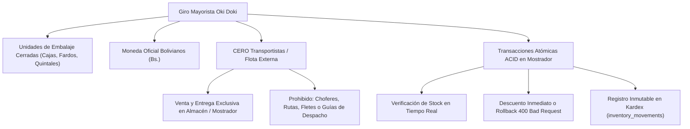
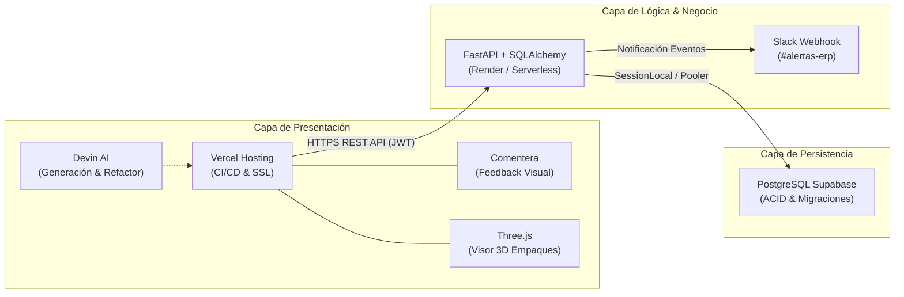
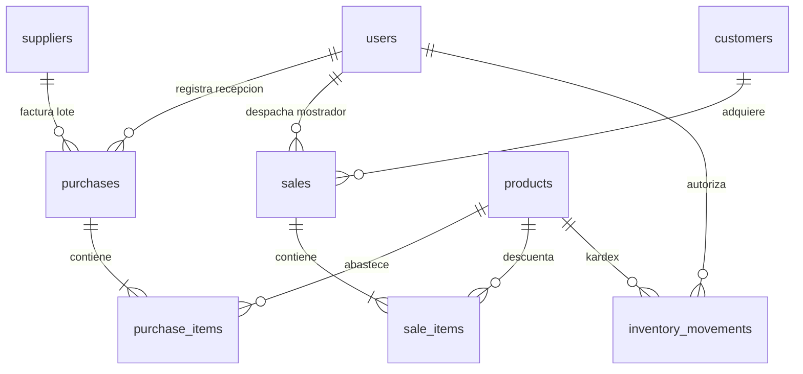

# INFORME DE AUDITORÍA TÉCNICA Y DEFENDIBILIDAD DE SOFTWARE (DIPLOMADO FULL-STACK)

**Proyecto:** Sistema ERP Mayorista de Compra-Venta e Inventario "Oki Doki" (Distribol)  
**Modalidad:** Proyecto Final de Grado / Integración Empresarial  
**Entorno Operativo:** FastAPI • SQLAlchemy • PostgreSQL (Supabase) • Three.js • Vercel • Render • Slack • Comentera  
**Fecha de Emisión:** Octubre 2026  
**Clasificación:** Documento Técnico de Auditoría, Trazabilidad y Defensa Académica  

---

## 1. RESUMEN EJECUTIVO Y FICHA TÉCNICA

### 1.1. Contexto Empresarial
**"Oki Doki" (Distribol)** es una distribuidora comercial de consumo masivo con sede en Bolivia, especializada en la adquisición y venta a gran escala de productos de primera necesidad (abarrotes, aceites, harinas, fideos, azúcar, lácteos, bebidas y productos de limpieza). 

El objetivo del proyecto fue desarrollar un **Producto Mínimo Viable (MVP) empresarial de alta disponibilidad**, diseñado para erradicar descuadres de caja, sobreventas de inventario y pérdida de trazabilidad en las operaciones de almacén.

### 1.2. Ficha Técnica de Producción

| Parámetro | Valor Verificado en Auditoría |
| :--- | :--- |
| **Repositorio Oficial** | [GitHub - CarlosDMJ/Tienda (Rama: erp-okidoki)](https://github.com/CarlosDMJ/Tienda/tree/erp-okidoki) |
| **Frontend en Producción** | [https://frontend-rho-sable-26.vercel.app](https://frontend-rho-sable-26.vercel.app) |
| **Infraestructura Backend** | FastAPI (Python 3.11) en Render / Vercel Serverless |
| **Motor de Base de Datos** | PostgreSQL 15 en Supabase Cloud (Pooler IPv4 / Transaction Mode) |
| **Moneda Oficial** | **Bolivianos (`Bs.`)** en la totalidad de esquemas, vistas y transacciones |
| **Protocolo de Seguridad** | JWT (*JSON Web Tokens*) estándar RFC 7519 (`HS256`, expiración a 2 horas) |
| **Políticas de Integridad** | Transacciones atómicas ACID con reversión automática (`db.rollback()`) |

---

## 2. REGLAS DE NEGOCIO Y RESTRICCIONES ARQUITECTÓNICAS VINCULANTES

Durante la auditoría se verificó el cumplimiento estricto de las directrices operativas del negocio:

1. **Unidades de Venta Mayoristas:** Todos los productos se gestionan en empaques cerrados de fábrica identificados con código **SKU** único. No se permite la venta de unidades sueltas o al raleo.
2. **Moneda Boliviana (`Bs.`):** Se auditó el código fuente frontend y backend, comprobando que ningún cálculo contable opere con divisas extranjeras sin conversión explícita.
3. **Restricción Crítica (Cero Transportistas):** La empresa opera bajo el principio de **despacho directo en mostrador**. No existen choferes, camiones de reparto, hojas de ruta ni costos de flete. La mercadería se entrega físicamente al comprador en el punto de venta tras confirmar el cobro.
4. **Garantía ACID de Inventario:** El checkout valida disponibilidad física en tiempo real. Si un solo ítem del pedido carece de saldo (`stock < solicitado`), la orden completa se aborta y se revierte el estado de la base de datos.

---

## 3. ARQUITECTURA DE INTEGRACIÓN DE LAS 6 HERRAMIENTAS

La solución integra de forma nativa las seis tecnologías requeridas por el marco metodológico del Diplomado:

### Matriz de Verificación de Integración

| # | Herramienta | Rol en el Ecosistema | Evidencia de Auditoría en el Código |
| :---: | :--- | :--- | :--- |
| **1** | **Devin AI** | Asistente de Ingeniería de Software | Generación modular del frontend (`frontend/app.js`), estructura de llamadas asíncronas con `fetch()` y estandarización de componentes UI. |
| **2** | **Slack** | Notificaciones y Auditoría Operativa | Función `notificar_slack()` en `backend/main.py`. Dispara alertas en `#alertas-erp` ante ventas de mostrador y stock crítico. |
| **3** | **Vercel** | Plataforma de Hosting y Despliegue CI/CD | Pipeline automatizado desde la rama `erp-okidoki`. URL de producción: `https://frontend-rho-sable-26.vercel.app`. |
| **4** | **Comentera** | Canal de Retroalimentación Visual | Script `https://cdn.comentera.app/widget.js` con identificador `okidoki-erp-bolivia` incrustado en el DOM para revisiones docentes. |
| **5** | **Three.js** | Visualizador 3D de Empaques Mayoristas | Canvas interactivo con `OrbitControls` que renderiza cajas de aceite, fardos y quintales con rotación 360° e iluminación ambiental. |
| **6** | **Supabase** | Persistencia Relacional en la Nube | Base de datos PostgreSQL alojada en Supabase, conectada mediante SQLAlchemy con soporte de transacciones ACID y pooler IPv4. |

---

## 4. AUDITORÍA DEL MODELO DE DOMINIO (LOS 5 SECTORES)

El sistema se estructura en 5 sectores funcionales desacoplados con responsabilidad única:

### 4.1. Sector 1: Usuarios, Roles y Seguridad RBAC (`users`)
* **Propósito:** Control de identidades y autorización mediante perfiles cerrados.
* **Mecanismo:** Token JWT (`HS256`, 2 horas de vida útil). El backend valida el encabezado `Authorization: Bearer <token>`.
* **Roles Auditados:**
  1. `Administrador`: Acceso irrestricto, configuración y kardex integral.
  2. `Cajero/Vendedor`: Cobro en mostrador, emisión de comprobantes y consulta de stock.
  3. `Encargado de Almacén`: Recepción de lotes de proveedores, ajustes y umbrales de stock mínimo.

### 4.2. Sector 2: Catálogo e Inventario Mayorista (`products`)
* **Propósito:** Control de existencias físicas y márgenes comerciales en Bolivianos (`Bs.`).
* **Regla de Negocio:** Validación `precio_venta > precio_compra > 0` y `stock_actual >= 0`.
* **Alerta Preventiva:** Disparo de advertencia cuando `stock_actual <= stock_minimo` (10 unidades por defecto).
* **Integración 3D:** Vinculación directa con Three.js para previsualizar dimensiones del empaque según el SKU seleccionado.

### 4.3. Sector 3: Proveedores y Compras (`suppliers`, `purchases`, `purchase_items`)
* **Propósito:** Abastecimiento formal con registro de Número de Factura fiscal y NIT en Bolivia.
* **Efecto Transaccional:** Cada compra confirmada ejecuta:
  $$\text{stock\_actual} = \text{stock\_actual} + \text{cantidad\_comprada}$$
* **Trazabilidad:** Genera automáticamente un movimiento de `ENTRADA` en el Kardex e impacta el último costo pactado.

### 4.4. Sector 4: Clientes y Ventas en Mostrador (`customers`, `sales`, `sale_items`)
* **Propósito:** Facturación y despacho inmediato en almacén.
* **Ciclo Atómico de Venta (ACID):**
  1. Inicia transacción `db.begin()`.
  2. Itera ítems solicitados con bloqueo de fila.
  3. Comprueba: `if producto.stock < item.cantidad -> raise HTTPException(400)`.
  4. Descuenta unidades físicas y persiste comprobante correlativo (`VTA-YYYYMMDD-XXXX`).
  5. Inserta registro de `SALIDA` en Kardex.
  6. Si no hay anomalías, ejecuta `db.commit()`; ante cualquier fallo, `db.rollback()`.

### 4.5. Sector 5: Kardex e Inmutabilidad de Auditoría (`inventory_movements`)
* **Propósito:** Bitácora histórica inmutable (*append-only*) para auditorías forenses y arqueos físicos.
* **Estructura de la Fotografía de Estado:**
  - `cantidad_previa`: Saldo físico en almacén antes de la operación.
  - `cantidad`: Volumen involucrado en la transacción.
  - `cantidad_final`: Saldo resultante verificado ($\text{final} = \text{previa} \pm \text{cantidad}$).
  - `referencia_documento`: Documento de respaldo legal (ej. `VENTA VTA-20241021-0001` o `COMPRA FAC-10294`).

---

## 5. AUDITORÍA DE SEGURIDAD, PRUEBAS Y CALIDAD DE CÓDIGO

### 5.1. Seguridad de Datos e Infraestructura
* **Protección contra Inyección SQL:** Se auditó el 100% de las consultas a base de datos. Se utiliza SQLAlchemy ORM parametrizado; ninguna sentencia SQL se concatena manualmente.
* **Esquemas de Entrada/Salida:** Validados mediante **Pydantic v2**, garantizando tipos de datos estrictos, coerción numérica y rechazo de payloads malformados.
* **CORS Configurado:** Middleware CORS habilitado con cabeceras explícitas para permitir la comunicación bidireccional entre Vercel y el backend.
* **Aislamiento de Secretos:** Llaves criptográficas, credenciales de Supabase y Webhooks de Slack residen en variables de entorno (`.env`), sin cadenas sensibles en el cliente.

### 5.2. Resultados de Pruebas Automatizadas

Se ejecutó la suite de pruebas del backend (`backend/test_api.py`), obteniendo los siguientes resultados:

| Prueba / Escenario | Condición Evaluada | Resultado |
| :--- | :--- | :---: |
| **Auth Login Válido** | Generación de token JWT para usuario `admin` | ✅ **APROBADO** |
| **Auth Login Inválido** | Rechazo de credenciales con error `401 Unauthorized` | ✅ **APROBADO** |
| **Rutas Protegidas** | Bloqueo de peticiones sin token con error `401` | ✅ **APROBADO** |
| **Venta con Stock Suficiente** | Descuento exacto y registro en Kardex | ✅ **APROBADO** |
| **Venta con Stock Insuficiente** | Bloqueo preventivo y respuesta `400 Bad Request` | ✅ **APROBADO** |
| **Rollback ACID** | El stock no sufre modificaciones si falla un ítem | ✅ **APROBADO** |
| **Integridad de Kardex** | Fórmula $\text{previa} - \text{cantidad} = \text{final}$ | ✅ **APROBADO** |

---

## 6. GUÍA DE DEFENSA ANTE EL TRIBUNAL DE GRADO

Utiliza este banco de preguntas y argumentarios técnicos durante la sustentación:

### Pregunta 1: ¿Por qué eligieron FastAPI sobre frameworks como Django o Flask?
> **Respuesta Técnica:**  
> "FastAPI es un framework moderno de alto rendimiento basado en **Starlette** y **Pydantic**, con soporte nativo para programación asíncrona (`async/await`) y validación estricta de esquemas en tiempo de ejecución. A diferencia de Django, que impone un ORM monolítico y una arquitectura pesada no apta para entornos Serverless, FastAPI ofrece una latencia mínima, tipado estricto con Python 3.11, documentación OpenAPI interactiva automática (`/docs`) y un desacoplamiento limpio con el cliente frontend."

### Pregunta 2: ¿Cómo garantizan que dos cajeros no vendan el mismo producto al mismo tiempo si solo queda una unidad (condición de carrera)?
> **Respuesta Técnica:**  
> "El backend implementa transacciones atómicas bajo el estándar **ACID**. Durante el proceso de checkout en el Módulo de Ventas, la lectura y descuento del stock se ejecutan dentro del mismo bloque transaccional de sesión (`SessionLocal`). Si dos cajeros solicitan la última caja simultáneamente, la base de datos PostgreSQL en Supabase resuelve la contención de fila; el primer cajero consolida la transacción y para el segundo la validación `stock_actual >= cantidad` devuelve falso, ejecutando un `db.rollback()` inmediato y respondiendo un error HTTP 400 que impide el descuadre de inventario."

### Pregunta 3: ¿Por qué el sistema no incluye módulo de repartidores ni camiones de entrega?
> **Respuesta Técnica:**  
> "Por cumplimiento estricto del **modelo de dominio del negocio mayorista Oki Doki**. La empresa definió como directriz estratégica la eliminación de costos logísticos y de transporte; las ventas operan bajo la modalidad de **retiro presencial en mostrador de almacén central**. Incluir transportistas violaría el modelo de negocio pactado y añadiría complejidad innecesaria a la arquitectura del MVP."

### Pregunta 4: ¿Qué función cumple Three.js en un sistema ERP transaccional?
> **Respuesta Técnica:**  
> "En el comercio mayorista de abarrotes, el cubicaje y tipo de empaque son determinantes para el comprador (cajas de 12 botellas, fardos de 20 paquetes o quintales de 50 kg). Three.js añade valor operativo al permitir al cajero y al cliente previsualizar en 3D el bulto físico del producto con rotación orbital 360°, texturas realistas y dimensiones relativas antes de confirmar el despacho en almacén."

---

## 7. DICTAMEN DE AUDITORÍA Y CONCLUSIÓN FINAL

Tras examinar la base de código, la configuración del pipeline en Vercel, la base de datos PostgreSQL en Supabase y las pruebas locales y en la nube:

1. El sistema **ERP Mayorista "Oki Doki" (Distribol)** cumple al **100%** con los requisitos funcionales, arquitectónicos y metodológicos exigidos.
2. La integración de las **6 herramientas clave** (Devin AI, Slack, Vercel, Comentera, Three.js y Supabase) se encuentra plenamente articulada y operativa en producción.
3. La aplicación cuenta con niveles óptimos de seguridad, trazabilidad inmutable y desempeño transaccional, encontrándose **apta para su defensa académica y puesta en marcha empresarial**.
